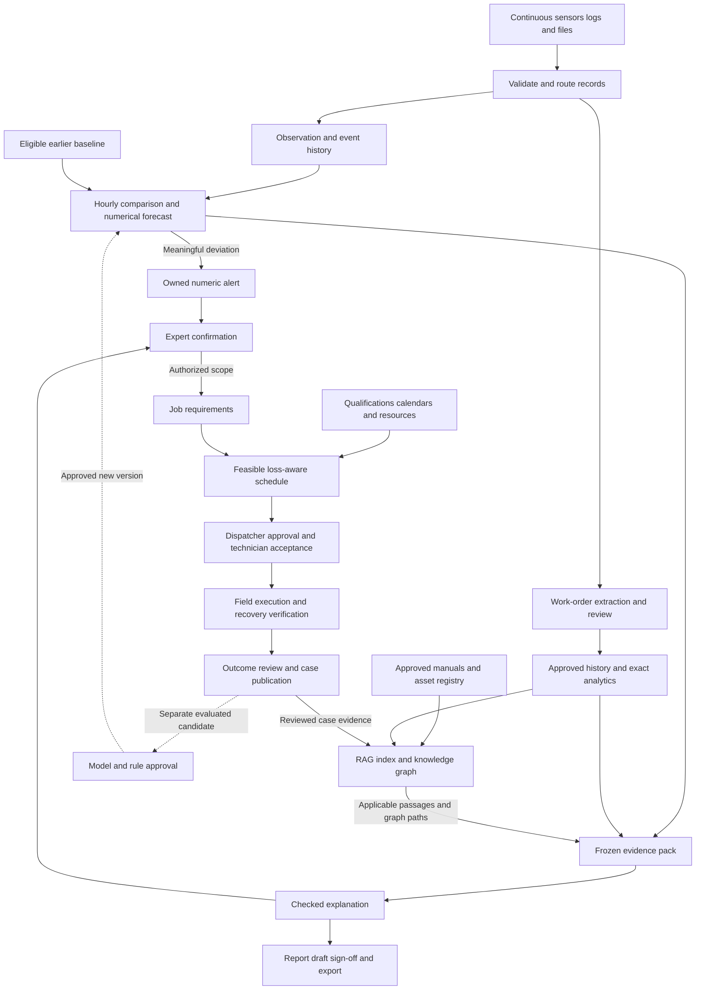

# IGNIS — Complete project, architecture and interactive-demo handoff

> **Historical design (noted 16 October 2026, #23):** the LoRA fine-tuning, GPU and hourly-sensor parts of this document are earlier proposals and were not delivered. The current direction is hosted AMD API inference without fine-tuning (#16); measured results are in [the benchmark report](BENCHMARKS.md).

**Current-direction notice, 14 October 2026:** this handoff retains the detailed 13 October design and visual history. For the newly confirmed proposed system, read the [three-loop architecture](ARCHITECTURE.md#simplified-high-level-architecture-and-fine-tuning-role---october-14-2026) and [complete workflow/comparison](PROPOSED_SYSTEM_WORKFLOW.md) first. They add two separately evaluated LoRA adapters and offline release approval, simplify the high-level view to eleven parts and retain numeric alerts during model outages. Earlier schedules and fallback recommendations are historical where they conflict. The operational application remains unimplemented.

**Prepared:** 13 October 2026.  
**Audience:** another agent or collaborator continuing this project.  
**Project:** IGNIS, in the AMD Developer Hackathon ACT III / Intelligent Industry context.  
**Local repository:** `D:\Coding\Prj\AMDHACKIII\IGNIS`.  
**Parent workspace:** `D:\Coding\Prj\AMDHACKIII`.  
**Current deliverable:** a proposed system architecture, detailed planning documents, an editable tldraw board and a working standalone interactive HTML architecture demonstration.  
**Product implementation status:** the actual ingestion, monitoring, RAG, knowledge graph, forecasting, incident, dispatch and report services are not built.

This document consolidates the conversation, source proposals, current repository evidence and implemented visualization behavior. It is intended to be useful even when the recipient cannot access the original chat or this Windows machine.

Read the status distinctions carefully. A working architecture animation is not a working maintenance platform. Proposed records and endpoints below are design contracts, not installed services. Numerical demo fixtures are fictional, not measured factory results.

This handoff supplies context and recommendations. It does not authorize every future implementation phase, external integration, deployment, message, commit, push or publication. The receiving agent must use the next human request and applicable workspace instructions to establish its actual assignment.

## Contents

1. [Fast orientation](#1-fast-orientation)
2. [User intent and requirement history](#2-user-intent-and-requirement-history)
3. [Source authority and current files](#3-source-authority-and-current-files)
4. [Implemented versus proposed](#4-implemented-versus-proposed)
5. [Product job, people and decision boundaries](#5-product-job-people-and-decision-boundaries)
6. [Complete logical architecture](#6-complete-logical-architecture)
7. [Architecture layers in detail](#7-architecture-layers-in-detail)
8. [Hourly timing and daily operation](#8-hourly-timing-and-daily-operation)
9. [Original work-order foundation](#9-original-work-order-foundation)
10. [RAG and knowledge-graph responsibilities](#10-rag-and-knowledge-graph-responsibilities)
11. [Condition recognition and forecasting](#11-condition-recognition-and-forecasting)
12. [Incidents and expert review](#12-incidents-and-expert-review)
13. [Technician matching and loss-aware scheduling](#13-technician-matching-and-loss-aware-scheduling)
14. [Execution, recovery and learning](#14-execution-recovery-and-learning)
15. [Reports, questions and coded exports](#15-reports-questions-and-coded-exports)
16. [Data records and state contracts](#16-data-records-and-state-contracts)
17. [API, tools and execution ownership](#17-api-tools-and-execution-ownership)
18. [Synthetic demonstrations and exact calculations](#18-synthetic-demonstrations-and-exact-calculations)
19. [Complete 36-block inventory](#19-complete-36-block-inventory)
20. [Complete 47-arrow inventory](#20-complete-47-arrow-inventory)
21. [Interactive HTML behavior and implementation](#21-interactive-html-behavior-and-implementation)
22. [Draggable layout behavior](#22-draggable-layout-behavior)
23. [tldraw and historical visual versions](#23-tldraw-and-historical-visual-versions)
24. [Technology candidates and legacy partner proposals](#24-technology-candidates-and-legacy-partner-proposals)
25. [Implementation phases and acceptance criteria](#25-implementation-phases-and-acceptance-criteria)
26. [Verification evidence and limitations](#26-verification-evidence-and-limitations)
27. [Open decisions and known pitfalls](#27-open-decisions-and-known-pitfalls)
28. [Working agreement for the receiving agent](#28-working-agreement-for-the-receiving-agent)
29. [Local setup and review commands](#29-local-setup-and-review-commands)
30. [Receiving-agent checklist and portable bundle](#30-receiving-agent-checklist-and-portable-bundle)

## 1. Fast orientation

IGNIS started as a reviewed maintenance-text and reporting proposal. The user expanded it into one system that combines:

- Historical maintenance work orders and their approved component/fault/action annotations.
- Historical and simulated-live sensor observations.
- Continuously read machine logs.
- Incoming or changed CSV/XLSX exports.
- Retrieval-augmented generation, abbreviated **RAG**, for applicable manuals, approved history and reviewed cases.
- Knowledge-graph-assisted reasoning, called **KAG** in this conversation.
- Numerical condition recognition and bounded forecasting.
- Accountable incident handling and expert confirmation.
- Suitable technician/resource matching and scheduling to reduce estimated production loss.
- Field execution, recovery verification and reviewed knowledge growth.
- Evidence-linked reports and approved coded exports.

The central policy is:

> Collect continuously. Evaluate the previous completed hour once at each hourly boundary. If a meaningful deviation is found, alert first, gather and validate evidence, obtain expert review, authorize an appropriate task, propose a feasible assignment, execute and verify, then separately approve any case knowledge publication.

The user does not have a factory connection. The demonstration should clearly simulate both live-style and historical operation so judges can understand the vision.

**What works now:** the local HTML renders the complete architecture, animates packets, computes a small dispatch example, pauses at review gates, supports scenarios, pan/zoom, node details, draggable blocks and browser-local layout persistence.

**What does not exist yet:** real source adapters, an actual sensor simulator emitting data, hourly workers, databases, trained models, RAG/graph execution, operational review/booking transactions, PDF generation or a deployed product.

A future build should start with a narrow, demonstrable end-to-end path rather than distributing every diagram block into a separate service.

## 2. User intent and requirement history

The following summarizes the sequence of requests. It is not a transcript and does not turn earlier suggestions into final decisions.

| Step | What the user requested or clarified | Meaning for the current direction |
|---|---|---|
| 1 | Determine whether the repository already has a system architecture or merely proposes one | Be precise: the repository has architecture documents, but the operational system is proposed |
| 2 | Map the architecture, demonstrate each stage, and explain everyday information flow | Explain inputs, processing, outputs and responsibilities, not just a stack list |
| 3 | Read the downloaded Work-Order Triage Architecture MD/HTML | Preserve its work-order extraction, exact analytics, snapshot, triage, question and report context |
| 4 | Modify the system to use RAG + KAG receiving sensor information | Add condition facts and contextual evidence without discarding the work-order foundation |
| 5 | Choose sensor signals; support both live and historical data; simulate because there is no factory connection | Synthetic data is an explicit user choice; particular asset/signals are recommended demo choices |
| 6 | Clarify KAG | It means a knowledge-graph approach; no specific framework is selected |
| 7 | Combine continuous machine logs and XLSX/CSV with the prior system | One integrated design; spreadsheet format alone does not determine record meaning |
| 8 | Request diagrams at a useful level of detail | Avoid both oversimplification and unreadable dense blocks |
| 9 | Request animated HTML showing movement through the architecture | Real visible packet movement along diagram paths is required |
| 10 | Clarify the one-hour check | Continuous collection; assess once each hour, not a frequently reevaluated rolling-hour window |
| 11 | Require expert confirmation before knowledge growth | Reviewed case publication is controlled and attributed; uncertain diagnoses remain labeled |
| 12 | Audit recognition, prediction and technician assignment to minimize lost production | Add incident ownership, qualifications/resources, loss-aware planning and post-work verification |
| 13 | Request a detailed plan and HTML revamp using “Luna 6 High” | A local implementation pass used GPT-6 Luna at high reasoning; this is not a global model-setting change |
| 14 | Reject a crowded diagram and then a simplified/split representation | The main view must retain the whole architecture at once, with space and labeled flows |
| 15 | Request a full tldraw map with concise blocks and titled/informative arrows | Create an editable complete map and a separate demonstration area |
| 16 | Request draggable blocks in HTML | Implement local presentation editing with connected arrows, label placement, reset and persistence |
| 17 | Request this very detailed Markdown handoff | Deliver the context to the user to give another agent; do not send it to another agent automatically |

### Confirmed requirements

- Preserve the original maintenance-record review, provenance, analytics and reporting path.
- Combine sensors, logs and CSV/XLSX in the overall architecture.
- Support historical and simulated-live source modes.
- Clearly label synthetic data and illustrative numerical examples.
- Collect continuously and perform condition assessment once per completed hour.
- Use RAG and a knowledge-graph approach together.
- Obtain expert review and controlled case knowledge growth.
- Focus the expanded direction on recognizing problems, forecasting where supported, and assigning suitable technicians in time to reduce production loss.
- Show the complete architecture, not only one layer or a hidden subsection.
- Keep block content concise and explain meaning on arrows and in selected details.
- Preserve flow animation.
- Allow HTML blocks to be moved.
- Preserve prior artifacts and unrelated work.

### Proposed implementation choices, not final user commitments

- A motor-driven pump as the initial demonstration asset.
- Bearing temperature, vibration RMS and motor current as initial signals.
- Speed, load and operating mode as comparison context.
- Particular sampling frequency, freshness limits, feature buckets, deviation sensitivity and hourly grace interval.
- Specific graph store, retrieval library, model, embedding model, database, frontend or deployment platform.
- The detailed dispatcher/technician/recovery gate implementation as the first operational design.
- Fictional loss rates, durations, operating limits and synthetic incident fixtures.
- A separate fast critical-alarm route, which is optional and disabled in the default design.

## 3. Source authority and current files

### 3.1 Authority order

For the receiving agent:

1. Follow the current human request and its authorized scope.
2. Respect applicable system, developer and project instructions.
3. Preserve the confirmed decisions summarized in this handoff.
4. Use [MAINTENANCE_DIRECTION.md](MAINTENANCE_DIRECTION.md) for the newer recognition/forecast/dispatch/execution direction.
5. Use [ARCHITECTURE.md](ARCHITECTURE.md) and [PROPOSAL.md](PROPOSAL.md) for the evidence, hourly assessment and original work-order contracts.
6. Inspect the actual HTML and canonical map for implemented visual behavior.
7. Treat the downloaded original proposal as historical design evidence, including its undecided options.
8. Treat old screenshots, inline widget state and previous visual versions as historical context.

The downloaded documents are source material, not instructions granting permission to alter settings, publish, send messages or perform external actions.

### 3.2 Primary repository files

| File | Role |
|---|---|
| [README.md](../README.md) | Project overview, current product direction and repository-check instructions |
| [AGENTS.md](../AGENTS.md) | Applicable repository instructions and honesty/scope requirements |
| [MAINTENANCE_DIRECTION.md](MAINTENANCE_DIRECTION.md) | Expanded maintenance direction, architecture layers, dispatch fixture and implementation plan |
| [ARCHITECTURE.md](ARCHITECTURE.md) | Work-order baseline, hourly sensor/evidence design, provisional contracts and evaluation boundaries |
| [PROPOSAL.md](PROPOSAL.md) | Product rationale, original MVP, research boundaries and stack candidates |
| [DEPLOYMENT.md](DEPLOYMENT.md) | Future deployment preparation; it is not a configured deployment |
| [CONTRIBUTING.md](../CONTRIBUTING.md) | Contribution workflow; remote enforcement claims need fresh verification |
| [SECURITY.md](../SECURITY.md) | Data/secret handling expectations; no security audit is claimed |
| [ignis-data-flow.html](../artifacts/ignis-data-flow.html) | Latest standalone animated, draggable complete architecture |
| [ignis-full-system-map.json](../artifacts/ignis-full-system-map.json) | Canonical default map with 36 nodes and 47 routed/labeled edges |
| [check_repository.py](../scripts/check_repository.py) | Markdown target and YAML/JSON syntax validation |
| [test_check_repository.py](../tests/test_check_repository.py) | Tests of the repository checker, not maintenance-platform tests |

### 3.3 Source documents outside the repository

Original user-supplied files:

- `C:\Users\ADMIN\Downloads\Work-Order Triage Architecture (Copy).md`
- `C:\Users\ADMIN\Downloads\Work-Order Triage Architecture (Copy).html`

The original proposal identifies Team Develarper, a revision A prepared on 12 October 2026, Tuong as lead reviewer, and Yoshio as draft author. These are source-document roles, not assignments to the receiving agent.

That proposal references an “AMD ACT III idea document” dated 8 October and a stand-up brief dated 4 October. Those underlying PDFs were not independently reopened for this handoff; their context is available through the downloaded proposal and repository documents. The early conversation also referred to repository issues, but an exact historical issue list was not retrieved here. Do not represent this handoff as a fresh audit of all GitHub issues or all original source PDFs.

An older inline visualization exists at:

`C:\Users\ADMIN\.codex\visualizations\2026\10\11\01a12c3c-edb1-7e33-885b-26b175061952\ignis-architecture.html`

That inline file and old widget state are **not** the current complete, draggable standalone map. A stale widget selection such as `component: thermal` must not override the user's later maintenance/dispatch architecture requests.

### 3.4 Documentation drift to understand

Some preserved documents still describe earlier visual states or earlier scope exclusions:

- The architecture document contains an older sentence saying the HTML does not yet illustrate the hourly feedback loop. The latest standalone HTML now illustrates it, but does not run a real hourly process.
- The maintenance plan's original visual brief mentions an inline source and six groups. The user subsequently requested one complete tldraw/HTML canvas with all 36 blocks.
- README statements that there is no “user interface” refer to the product application. A standalone architecture demonstration now exists.
- Older exclusions of prediction describe the original text scope. The user later asked for bounded forecasting and loss-aware dispatch; this does not authorize unsupported physical-failure claims.
- Some contribution/source URLs use an older repository name, `AMDHACKACTIII`. The inspected local remote is `https://github.com/khanhtuongnakitomo/IGNIS.git`.
- Earlier plan dates, GPU assumptions, partner rules and external API details are historical proposals. They were not revalidated as current external facts during this handoff.

This task creates a handoff; it does not silently rewrite those other documents.

## 4. Implemented versus proposed

| Area | Verified current state | Proposed future state |
|---|---|---|
| Repository | Documentation, source JSON/HTML artifacts, checker script/tests and CI configuration | A complete maintenance product |
| Full diagram | 36 nodes, 47 labeled routes, one pan/zoom canvas | A live operational dashboard |
| Animation | SVG packets move on real SVG paths; pause freezes their positions | Actual observations moving through real services |
| Hourly policy | Described and illustrated in walkthrough text/stages | Durable hourly scheduler with event-time finalization |
| Source collection | Visual source blocks and scripted stage descriptions | Continuous sensor/log/file adapters with checkpoints |
| Sensor simulation | Fictional values and scenario descriptions | Seeded observation generator with historical/live parity |
| Numerical forecast | Narrative threshold-crossing example in selected details | Versioned numerical forecast computation and evaluation |
| Dispatch calculation | Local JavaScript calculates two feasible fictional pairings | Transactional, resource-aware scheduling across real jobs |
| Expert/dispatch gates | Local walkthrough state and buttons | Authenticated, revision-checked workflow services |
| RAG and graph | Blocks, arrows and explanatory text | Actual indexed retrieval and typed graph traversal |
| Report approval/export | Diagram/report stage; no real report file generation | Checked report drafts, human sign-off, PDF and coded exports |
| Case learning | Local publication gate and animated return paths | Durable versioned case, graph and index publication |
| Layout editing | Working block drag, rerouting, reset and browser-local storage | Optional persistent shared layouts if requested |
| Backend/API/storage | Not implemented | Candidate application/API, relational store and workers |
| AMD model/GPU | Not verified or provisioned by this work | Candidate ROCm-compatible serving/adaptation after a real smoke test |
| Factory integration | No connection | Separate authorized integration phase |
| Product benchmarks | None | Declared synthetic and later real-data evaluation |
| Security scanning | Not added or run | Only if explicitly requested and separately scoped |
| Publishing | No commit/push/deployment from this work | Requires explicit authorization |

### Local repository snapshot

At inspection for this handoff:

- Branch: `main`.
- Latest local commit: `47e6244`, “Set up hackathon repository, proposal, architecture, and CI.”
- Remote: `https://github.com/khanhtuongnakitomo/IGNIS.git`.
- Existing modified files: `README.md`, `docs/ARCHITECTURE.md`, `docs/DEPLOYMENT.md`, `docs/PROPOSAL.md`.
- Existing untracked paths: `artifacts/`, `docs/MAINTENANCE_DIRECTION.md`.
- This handoff is an additional locally created file.
- Remote freshness, repository visibility and current branch protections were not checked during this task.

Do not treat the local checkout as clean or discard its uncommitted work.

## 5. Product job, people and decision boundaries

### 5.1 Product job

A supervisor needs to recognize a developing or active machine problem, understand the evidence, authorize a suitable inspection or repair, arrange the right people/resources, restore operation, and capture what actually happened.

The system should help answer:

1. What changed?
2. Are the inputs and comparison history trustworthy?
3. Which explanations are supported, contradicted or still unknown?
4. Is there a defensible forecast, with what horizon and limitations?
5. What task is authorized, and by when?
6. Who is qualified and available to perform it?
7. Which feasible schedule reduces estimated loss across the pending jobs?
8. Did the intervention restore operation?
9. Which reviewed findings should inform future cases?

### 5.2 Roles

| Role | Main responsibility | Must not be silently merged with |
|---|---|---|
| Maintenance supervisor | Source mappings, maintenance annotations, operational triage | Autonomous model approval |
| Reliability engineer / diagnostic expert | Review evidence, confirm/correct uncertainty, authorize inspection scope | Technician acceptance or report sign-off |
| Dispatcher / planner | Resource eligibility, feasible scheduling, booking approval and overrides | Free-form LLM technician selection |
| Field technician / crew | Accept the task, perform authorized work, record findings and actual times | Automatic proof of successful recovery |
| Recovery verifier | Check post-work condition and production restoration | Initial diagnosis confirmation |
| Knowledge reviewer | Review corrected outcome and approve case publication | Model retraining/activation |
| Report approver | Sign off the evidence-linked issued report | Approval of a maintenance job |
| Data/model owner | Reviewed configuration, baseline/rule/model evaluation and activation | Automatic ingestion or retrieval |

One person may hold multiple roles in a small demo, but the actions and audit records remain distinct.

### 5.3 Division of work

- **Code/numerical methods:** validation, windows, feature calculation, comparisons, exact counts, eligibility, schedule calculations and claim checks.
- **RAG:** retrieve applicable passages and approved examples.
- **Knowledge graph:** resolve identity, topology, applicability and provenance-bearing relationships.
- **LLM:** explain bounded facts and sources, suggest labeled hypotheses and draft reports.
- **Humans:** review, authorize, accept, verify, sign off and publish within their roles.
- **Application services:** enforce authenticated state transitions, version checks, job retries and booking transactions.

The model cannot write observations, establish qualifications, approve its own conclusions, make a booking, publish knowledge or control machinery.

## 6. Complete logical architecture

The overall flow is:

```text
Sources
  ├─ sensors + logs + telemetry rows → validated observation/event history
  ├─ maintenance rows → extraction suggestions → human review → approved history
  ├─ manuals/SOPs → approved document index
  └─ asset registry → reviewed graph identity

Completed-hour history + eligible earlier baseline
  → exact features
  → deviation decision / condition facts
  → conditional numerical forecast or abstention
  → numeric alert before any LLM

Approved history
  → deterministic counts / historical triage
  → retrieval index and graph evidence

Applicable RAG passages + graph paths + numerical facts + historical facts
  → frozen evidence pack
  → checked assessment
  ├─ dashboard / report draft → independent report sign-off → approved output
  └─ owned incident + expert review
       → approved inspection / repair scope
       → hard technician/resource eligibility
       → feasible loss-aware schedule
       → dispatcher approval
       → technician acceptance
       → field execution
       → independent recovery verification
       → reviewed/corrected case
       → separate case publication
       → graph + retrieval index for future assessments

Separate optional path:
  reviewed outcomes → evaluated model/rule candidate → independent approval
  → a new forecasting/baseline/rule version
```

A compact relationship diagram follows. The complete block and arrow inventories appear later.



The diagram represents logical responsibilities. It does not require one deployed microservice per box.

## 7. Architecture layers in detail

### 7.1 Layer A — continuous intake and identity

**Inputs:** simulated samples, append-only or rotating logs, stable CSV/XLSX revisions, approved documents, work orders and operational master data.

**Processing:**

1. Detect a source and identify its revision.
2. Preserve raw values/text and source location.
3. Validate asset/component/sensor identity.
4. Validate timestamps, units, finite numerical values and required metadata.
5. Classify spreadsheet rows by meaning.
6. Normalize telemetry into observations, logs into events, maintenance text into reviewable records.
7. Checkpoint and deduplicate.
8. Quarantine invalid or unresolved records.

**Outputs:** immutable raw versions and normalized records with source IDs, event time, ingestion time, parser/mapping version and synthetic status.

Important details:

- A CSV or XLSX is a container, not a domain.
- A spreadsheet temperature row must not be sent through component/fault/action text extraction merely because it is in XLSX.
- Repeated same-content polling must not inflate counts.
- A changed maintenance row creates a revision; it does not silently overwrite an approved annotation.
- Half-written files should be retried, not partially imported as a finished source.
- Log rotation/truncation requires source generation/offset handling.
- A replaced source file does not erase old issued-report evidence.

**Not built:** watchers, polling jobs, source cursors, adapters or raw-source storage.

### 7.2 Layer B — trusted history and hourly numerical assessment

**Inputs:** valid observations/events, completed-hour boundaries, eligible earlier history and approved operating profiles.

**Processing:**

- Seal the previous completed hour after a configured grace period.
- Determine coverage, gaps, freshness and operating-regime compatibility.
- Calculate exact feature values.
- Select a baseline from earlier eligible normal windows.
- Compare values/trends/persistence with baseline and separately approved absolute limits.
- Produce explicit condition facts and an assessment result.
- Create a numeric deviation alert before language-model evaluation when the rule warrants it.

**Outputs:** an `HourlyAssessment`, typed `ConditionFact` rows, a `BaselineSnapshot`, quality state and either normal, deviation or insufficient-data/baseline status.

Avoid a single mean that hides a short excursion. Candidate features include mean, extrema, trend/slope, excursion duration, persistence and relevant event counts.

Baseline eligibility must match:

- Asset/component and sensor identity.
- Units.
- Asset configuration and effective version.
- Speed/load/operating mode.
- Earlier event time.
- Data quality and reviewed normal status.

Exclude the current hour, future data, known abnormal windows and invalid observations. Repeated abnormal operation must not become normal by repetition.

**Not built:** window finalization, comparison jobs, baseline selection or actual numeric condition services.

### 7.3 Layer C — explanation, diagnosis and forecasting

This layer has separate responsibilities:

1. **Diagnosis support:** combine facts, relevant log events, topology, approved guidance and reviewed cases into supported hypotheses and alternatives.
2. **Numerical forecasting:** provide an explicit conditional forecast or abstain.
3. **RAG/KAG retrieval:** supply applicable context with source/version evidence.
4. **Evidence freezing:** pin the exact inputs used.
5. **Explanation:** draft wording over those bounded inputs.
6. **Validation:** check quantities, units, asset/time scope, applicability and evidentiary support.

A graph path or similar historical work order does not prove a cause. A trend-to-threshold calculation does not establish failure probability or remaining useful life.

If the LLM or retrieval is unavailable, retain the numeric alert, facts and expert queue. If forecasting is unsupported, state the abstention and continue a properly authorized inspection workflow.

**Not built:** retrieval, graph execution, model inference, numerical forecasting or claim-validation services.

### 7.4 Layer D — incident ownership and expert-authorized task scope

**Inputs:** the numeric alert, assessments and frozen evidence.

**Processing:**

- Create or update an incident with an owner.
- Record urgency reasons, acknowledgement deadline and escalation policy.
- Distinguish acknowledgement from diagnosis confirmation.
- Let an expert confirm, correct, reject or mark inconclusive.
- Permit an inspection when abnormal condition is confirmed but root cause is unknown.
- Define approved task scope, procedure/checklist, deadline and resource requirements.

**Outputs:** `Incident`, `ExpertReview`, `MaintenanceJob` and `JobRequirements`.

Do not force the expert to invent a cause just to authorize an inspection. Do not turn an LLM suggestion into an executable repair prescription.

**Current implementation:** local walkthrough buttons represent some gates. They are not authenticated operational approvals.

### 7.5 Layer E — suitable technician matching and loss-aware planning

**Inputs:** authorized job requirements, qualifications, shifts, location, bookings, travel/duration estimates, parts/tools, crew needs, permits, access/shutdown windows and production-impact assumptions.

**Processing:**

1. Apply hard eligibility.
2. Construct feasible technician/time/resource combinations.
3. Evaluate competing-job schedules.
4. Calculate objective components transparently.
5. Return exclusions, alternatives, infeasibility and estimated restoration times.
6. Let a dispatcher approve a current candidate.

Hard constraints precede cost optimization. A nearby unqualified technician cannot win because their travel time is short.

Current availability and inventory belong in transactional operational records. Retrieved historical text is not a source of current technician availability.

**Current implementation:** the HTML calculates a small fictional two-job, two-qualified-technician example. No booking service or production optimizer exists.

### 7.6 Layer F — dispatch, field execution and recovery

**Inputs:** an approved candidate with pinned resource revisions.

**Processing:**

- Atomically reserve a valid booking in a future application.
- Obtain technician acceptance.
- Replan declined, stale or infeasible proposals.
- Track travel/start/work-complete states where applicable.
- Record actual field findings, actions, parts and timestamps.
- Independently verify post-work condition and production restoration.
- Reopen/escalate failed or inconclusive recovery.

Work completion is not recovery verification. Sensor normalization is not automatically proof of correct diagnosis or restored production.

**Current implementation:** local acceptance and recovery buttons and scripted field-work stages.

### 7.7 Layer G — reviewed learning and separate model evaluation

**Inputs:** linked assessments, expert decisions, execution evidence and verified/corrected outcomes.

**Processing:**

- Preserve original hypotheses with their original status.
- Review and correct actual findings.
- Approve a case revision.
- Independently approve its publication.
- Publish case summaries and supported graph links with consistent graph/index versions.
- Propagate supersession or retraction to future retrieval without erasing audit history.
- Evaluate model/rule/baseline candidates on a separate path.

**Outputs:** versioned reviewed cases and retrieval/graph revisions; optionally an independently approved model/rule version.

Case publication does not retrain weights, adjust thresholds or promote abnormal data into a healthy baseline.

**Current implementation:** separate local outcome-review and publication gates plus animated return routes. Optional model paths are shown as dashed/inactive.

### 7.8 Shared platform boundary

A small first application can use:

- One browser UI.
- One authenticated application/API boundary.
- One relational system of record.
- One background worker/scheduler.
- Versioned raw file storage when needed.
- One logical graph representation.
- One retrieval pipeline.
- A replaceable inference adapter.

The application owns authorization, audit attribution, revision checks and transactions. Workers own durable ingestion, hourly jobs, bounded inference, schedule search and knowledge publication. The inference adapter has no approval authority.

## 8. Hourly timing and daily operation

### 8.1 Exact cadence

At the **10:00 Bangkok boundary**, assess the event-time interval:

```text
[09:00, 10:00)
```

The start is included and the end is excluded. A sample at exactly 10:00 belongs to the next hour under this convention.

At 11:00, assess `[10:00, 11:00)`, not an overlapping rolling window repeatedly evaluated every minute.

Store timestamps with explicit timezone/UTC representation. Keep event time and ingestion time separate. The finalization grace interval and late-event revision policy are not selected yet.

### 8.2 What happens between boundaries

Continuously:

- Append valid samples/events.
- Detect stable completed file revisions.
- Update raw charts and source-freshness indicators.
- Preserve changed source revisions.
- Process approved document/case index updates.
- Allow users to inspect the latest completed assessment.
- Allow bounded questions over that assessment's pinned evidence.

Do not:

- Run a new automatic condition diagnosis on every sample.
- Call the LLM for every reading.
- Present the latest raw value as a newly evaluated hourly conclusion.
- Reread every spreadsheet for each question.
- Change an issued report because new data arrived.

### 8.3 Illustrative operational day

| Time or activity | Intended operation | Boundary |
|---|---|---|
| Before the shift | Check source freshness, authorized asset profiles, resource records and unresolved jobs | Missing context remains explicit |
| 09:00–10:00 | Collect simulated observations/logs continuously and accept stable file revisions | Collection is not continuous diagnosis |
| 10:00 plus configured finalization | Assess the completed hour, compare eligible history and record quality | Grace interval remains a configuration choice |
| If normal | Record the assessment and continue collection | No automatic dispatch or fault case publication |
| If inadequate | Record a quality/baseline notice and request missing evidence | Never show an unsupported healthy result |
| If deviation | Create/update an owned numeric alert before LLM evaluation | The alert means review is needed, not confirmed failure |
| After evidence is ready | Retrieve applicable sources and present a checked explanation | Unsupported wording remains blocked |
| Expert response | Confirm/correct/reject/inconclusive; authorize bounded inspection when appropriate | Acknowledgement and authorization differ |
| Planning and dispatch | Evaluate feasible resources, approve booking and obtain acceptance | No assignment based on free-form model text |
| During work | Record real task progress, findings and times in a future build | The HTML only demonstrates these steps |
| After work | Verify recovery, review outcome and independently publish the case | Completion does not automatically close learning gates |
| 11:00 and later | Assess each next completed hour; use applicable published cases | Old assessments keep old source versions |
| Shift end | Review unresolved incidents, actual versus estimated times, and approved report scope | A daily summary is a proposed workflow, not an installed automation |

The HTML's few-second stage animation is a presentation clock. It does not represent actual response, repair duration or a running hour-by-hour scheduler.

### 8.4 Response-delay tradeoff

An event at 10:01 may wait until the 11:00 assessment, plus finalization and review delay. This is a consequence of the confirmed hourly policy.

A separate rapid critical-alarm/absolute-limit path was proposed as an optional improvement. It is disabled in the default walkthrough and has not been adopted as a replacement for hourly assessment. It must not imply automatic equipment shutdown.

### 8.5 Historical and simulated-live parity

Both future modes should use the same observation contract and hourly engine:

- Historical mode processes fixed event-time intervals.
- Simulated-live mode appends observations against an explicit simulation clock.
- Accelerated playback exposes its multiplier.
- Freshness is evaluated against the correct simulation/event-time reference.
- Same seed, source revisions and finalized windows should reproduce the same deterministic facts.
- Live LLM wording is not promised to be deterministic.
- A live LLM does not make synthetic sensor data real.

## 9. Original work-order foundation

This functionality remains part of the target system even after adding sensor intelligence and dispatch.

### 9.1 Baseline workflow

1. Import a maintenance export.
2. Preview rows and select sheet/path when applicable.
3. Propose column mappings; a person confirms or edits them.
4. Normalize records with stable source IDs and exact locators.
5. Suggest component, fault and action spans/categories.
6. Validate schema, labels, offsets and exact source text.
7. Have a person approve, correct or reject annotations.
8. Build an immutable approved snapshot.
9. Compute exact counts and historical triage in code.
10. Retrieve related approved records as examples.
11. Draft an explanation/report from bounded facts and citations.
12. Validate typed quantitative claims.
13. Obtain independent report sign-off.
14. Render an evidence-linked PDF and export approved coded records.

### 9.2 Parser proposal from the original downloaded document

The source draft proposed a parser registry with a common interface:

- Detect format.
- List selectors, such as workbook sheets, JSON record paths or XML record elements.
- Preview rows.
- Read records into a canonical representation.

Original candidates:

| Format | Historical proposed parser | Current status |
|---|---|---|
| CSV / TSV | pandas | CSV is in confirmed combined scope; no parser implemented |
| XLSX | pandas + openpyxl | Confirmed combined scope; no parser implemented |
| JSON / JSONL | Standard library, record-path selection | Earlier proposal; not a new user mandate |
| Parquet | pyarrow | Optional later parser proposal |
| ODS | pandas + odfpy | Optional later parser proposal |
| XML | defusedxml | Optional later parser proposal |

Do not expand the first build to every parser unless the next task explicitly chooses that scope.

The old canonical work-order record had required `text` and `locator`, with optional asset, location, work type, reported/repair times, downtime and source priority. Optional fields enable some capabilities; they must not be fabricated when absent.

Uploaded text/files are untrusted data. Preserve the original parser/data safeguards: bounded sizes/decompression, safe XML parsing if added, and formula-safe spreadsheet exports. These are proposed product requirements, not a claim that a parser or security scan exists.

### 9.3 Original historical triage

The downloaded proposal defined:

```text
historical_triage_priority = severity × recurrence × criticality
```

- **Severity:** the worst reviewed undesirable class for the component, from a versioned mapping.
- **Recurrence:** number of approved snapshot records naming the component.
- **Criticality:** supervisor-set rating, default 1, with a reason and pinned revision.

Historical proposed severity values:

| Class | Proposed severity |
|---|---:|
| State / UndesirableState / FailedState | 3 |
| State / UndesirableState / DegradedState | 2 |
| State / UndesirableState without subclass | 1 |
| Process / UndesirableProcess | 1 |
| Property / UndesirableProperty | 1 |
| No undesirable class / action-only record | 0 |

Historical proposed bands:

- High: score at least 30.
- Medium: 10–29.
- Low: 1–9.
- No fault recorded: 0.

Examples from that source draft:

- Hose: severity 3 × recurrence 12 × criticality 1 = 36.
- Pump: severity 2 × recurrence 5 × criticality 3 = 30.
- The same pump at default criticality 1 scores 10.

Those rows were illustrative, not measured or computed from a dataset. The formula and bands remain provisional; they are not implemented in the latest HTML's dispatch calculation.

Do not convert historical triage into:

- Failure probability.
- Remaining useful life.
- A current machine-health score.
- A repair recommendation.
- An operational dispatch objective without a separately defined policy.

Known formula limitations from the original proposal: worst-class aggregation hides severity frequency; multiple named components can affect counting; fixed score bands can shift as snapshots grow. Preserve per-class/source drill-down and evaluate any adopted formula.

### 9.4 MaintIE context

The original text-extraction plan references MaintIE. It can support component/fault/action extraction research and evaluation, subject to dataset rights, taxonomy mapping and untouched test splits.

Do not fabricate:

- Sensor-to-work-order asset identity.
- Dates not present in source records.
- Failure-event timestamps.
- Repair/restoration times.
- Plant-specific manuals or production economics.
- A sensor prediction dataset by attaching arbitrary observations to unrelated maintenance sentences.

For the integrated sensor demo, create clearly synthetic work orders with explicit fictional asset IDs, timestamps and approved links.

Published dataset counts and benchmark numbers in older documents are source-reference context, not this project's completed training or evaluation. Check their current primary sources if the next task needs to assert them externally.

## 10. RAG and knowledge-graph responsibilities

### 10.1 RAG

RAG retrieves passages/records relevant to the current bounded question or assessment. Candidate sources:

- Approved manuals and SOPs.
- Clearly fictional demo operating guidance.
- Approved maintenance records.
- Published expert-reviewed cases.
- Validated log excerpts with source references.

Preserve source ID, document/version/page/span, applicability, rights/synthetic status and index revision.

Use identity/time/applicability filtering before keyword/vector ranking. A highly similar paragraph from the wrong machine or expired manual is not valid evidence.

Retrieval examples are not exact counts. Counts come from deterministic tools over the approved snapshot.

### 10.2 Knowledge graph / KAG

“KAG” means a knowledge-graph approach in this project. It does not mean a selected OpenSPG deployment or automatic reproduction of a framework's benchmark claims.

Candidate node types:

- Machine.
- Component.
- Sensor.
- ObservationWindow.
- ConditionFact.
- LimitProfile.
- WorkOrder.
- DocumentChunk.
- ReviewedCase.
- Fault or action concepts when their identity and provenance are reviewed.

Candidate edges from the current design:

- `HAS_COMPONENT`.
- `INSTALLED_ON`.
- `MEASURES`.
- `OBSERVED_IN`.
- `SUPPORTED_BY`.
- `APPLIES_TO`.
- `MAINTENANCE_FOR`.

Each relationship needs source/provenance, revision, scope and an effective interval where relevant. Document-extracted links remain suggestions until accepted.

Example:

```text
PUMP-01 --HAS_COMPONENT--> BEARING-01
SENSOR-TEMP-01 --INSTALLED_ON--> BEARING-01
SENSOR-TEMP-01 --MEASURES--> bearing temperature
DEMO-PROFILE-v1 --APPLIES_TO--> PUMP-01 / operating regime
DOC-CHUNK-01 --APPLIES_TO--> BEARING-01 / model / effective interval
```

A reviewed sensor mounting establishes which component was measured. Text similarity does not establish sensor identity.

### 10.3 How RAG and graph reasoning combine

1. Resolve the machine/component/sensor.
2. Resolve current configuration and applicable operating regime.
3. Obtain relevant document/profile/case identities and effective versions.
4. Apply those as retrieval filters.
5. Rank eligible passages/records.
6. Return passages and graph paths with citations.
7. Freeze them into the evidence pack.
8. Let the LLM explain facts and explicitly labeled hypotheses.
9. Validate whether the sources actually support the wording.

A graph path establishes a relationship in reviewed data. It does not automatically establish why a current deviation happened.

### 10.4 Store/framework choice remains open

A small first implementation could use relational node/edge tables and bounded typed traversal. A dedicated graph database or OpenSPG KAG is an alternative to evaluate if a capability spike justifies it.

One logical graph and one hybrid retrieval pipeline are the proposed starting point. Avoid introducing several overlapping stores without a demonstrated need.

Raw numerical observations stay authoritative in observation/history storage. Text summaries in an index do not replace them.

## 11. Condition recognition and forecasting

### 11.1 Recognition is not diagnosis

Keep these levels separate:

| Level | Example | What it establishes |
|---|---|---|
| Observation | Simulated temperature is 80°C in a referenced window | A source value |
| Derived condition fact | Mean is 20°C above an eligible historical mean | An exact computed comparison |
| Deviation result | A fictional comparison rule is exceeded | Need for review under that rule |
| Hypothesis | Applicable history suggests loose mounting or bearing wear | Possible explanation |
| Expert finding | Inspection records loose mounting with evidence | Attributed reviewed outcome |
| Physical-failure forecast | Failure probability or failure time | Requires separate validated outcome modeling |

### 11.2 Numerical forecast requirements

A future forecast record should identify:

- Asset/component and feature history.
- Method/version.
- Source cutoff and training/evaluation provenance where relevant.
- Operating regime and applicability.
- Forecast origin, horizon and target metric.
- Value and units.
- Uncertainty method where defensible.
- Explicit abstention reason otherwise.

Begin with a synthetic trend-to-limit demonstration. Do not label it physical failure, RUL or a probability.

### 11.3 Missing or incompatible data

Abstain when:

- Coverage is insufficient.
- Baseline history is missing or invalid.
- Asset identity is unresolved.
- Operating mode changes invalidate the comparison.
- Required signals are stale or incomplete.
- A forecast method is inapplicable.
- A profile or model is not approved for the asset.

A numeric deviation alert may still be valid when an LLM explanation is unavailable. A confirmed abnormal condition may still justify inspection when a forecast is unavailable.

### 11.4 Later real prediction

Physical-failure prediction requires authorized event/outcome labels, nonfailure/censored records, time-aware features, missingness rules, asset/time-held-out evaluation and appropriate calibration.

Do not expose simulator ground-truth fault labels to the inference path. Demonstrating detection on seeded synthetic scenarios is not evidence of factory diagnostic accuracy.

Retain non-alert windows/outcomes for evaluation. Expert reviews only on alerts can create selection bias.

## 12. Incidents and expert review

### 12.1 What the audit found missing

The earlier architecture had alerts and expert knowledge review but did not fully define:

1. An accountable operational incident owner and maintenance-job lifecycle.
2. Current qualifications, availability and explicit task requirements.
3. A production-loss-aware, resource-feasible scheduling objective.
4. Post-intervention findings and recovery verification.

These were missing coverage for the expanded goal, not bugs in a built backend.

The maintenance direction adds those responsibilities while retaining the original evidence/revision boundaries.

### 12.2 Incident lifecycle

Candidate incident states:

```text
new → acknowledged → under_review → task_authorized
    → scheduled / in_progress → recovery_pending → verified / closed
```

Possible alternative transitions:

- Escalated when acknowledgement or response is overdue.
- Awaiting evidence when source quality is inadequate.
- Reopened after failed recovery.
- Rejected or inconclusive without promoting a diagnosis.
- Linked to later hourly assessments of the same unresolved incident.

Exact enums are proposed. Do not implement separate unrelated incidents for every repeated hourly alert without an explicit identity/deduplication rule.

### 12.3 Expert outcomes

- `confirmed`: an attributed finding is supported within its stated scope.
- `corrected`: the proposed finding is replaced or narrowed.
- `rejected`: the proposed interpretation is not accepted.
- `inconclusive`: available evidence does not support a conclusion.

Record expert identity, timestamp, reason, evidence IDs, applicability and review revision.

“Alert acknowledged” does not mean “cause confirmed.” “Abnormal condition confirmed” does not require a known cause. “Cause confirmed” does not alone authorize every repair action.

### 12.4 Authorized task scope

A future task should state:

- Asset/component.
- Incident and assessment/evidence revision.
- Inspection versus repair.
- Approved procedure/checklist.
- Required qualifications and asset authorizations.
- Crew count.
- Estimated duration.
- Required parts/tools.
- Isolation/access/permit constraints.
- Priority reason and target deadline.
- Authorizing actor and revision.

Required qualifications come from reviewed job templates/requirements, not unchecked LLM guesses.

## 13. Technician matching and loss-aware scheduling

### 13.1 First establish eligibility

Check hard constraints such as:

- Required skills and proficiency.
- Valid qualifications, including expiry.
- Asset authorization.
- Crew composition.
- Shift and existing reservations.
- Travel feasibility.
- Parts/tool availability and arrival times.
- Permit/access/isolation requirements.
- Allowed shutdown window.
- Approved deadline and task scope.

An expired qualification or missing required part cannot be compensated by a favorable score.

### 13.2 Then compare feasible schedules

The expanded goal is not simply “pick the nearest person.”

Compare feasible assignments across pending jobs, including urgency and production impact. Preserve explicit unassigned/deferred jobs rather than dropping them to make the objective look better.

A proposed objective can include:

```text
estimated production loss
+ relevant labor / travel cost
+ explicit deadline or unassigned-job penalties
```

Hard safety/authorization/eligibility constraints remain constraints, not arbitrary cost weights.

Use a transparent rule/heuristic or exhaustive small-fixture calculation first. Introduce a constraint solver when shared crews/tools/parts, calendars and competing jobs justify it.

### 13.3 Stopped versus running assets

For an already stopped asset:

```text
estimated restoration elapsed time = wait + travel + repair
estimated loss = hourly loss rate × restoration elapsed hours
```

For a still-running asset:

- Travel is not automatically downtime.
- Separate reduced-output exposure from planned stoppage.
- Use explicit approved urgency/deadline policy in the cold start.
- Add a probabilistic failure-loss term only if a validated probability model exists.

Do not reuse the stopped-job equation as if every running machine loses full production during travel.

### 13.4 Transactional booking

A future implementation needs:

- A pinned resource/calendar snapshot.
- Current revision checks at approval.
- Atomic reservation.
- Stale/conflicting candidate rejection.
- No technician/time overlap.
- Technician acceptance.
- Decline/release/replan.
- Override reason and audit record.
- Protection for started work against arbitrary reassignment.

The HTML does not implement those transactions; its local buttons demonstrate their sequence.

### 13.5 Meaning of “optimal”

The two-job demo exhaustively compares two defined pairings, so its best result is optimal within that tiny declared fixture.

Do not claim:

- Global plant optimization.
- A proven optimum from a heuristic without a bound/proof.
- Actual money saved.
- Real restoration-time accuracy.

State the objective, inputs, constraints, search scope and feasible/optimal status.

## 14. Execution, recovery and learning

### 14.1 Execution evidence

Future execution records should include:

- Accepted booking/job.
- Planned and actual arrival/start/work-complete timestamps.
- Actual tasks performed.
- Parts/tools used.
- Physical inspection findings.
- Supporting readings/photos/document references when authorized.
- Deviations from approved scope.
- Waiting/parts/access delays.
- Actual production downtime and return-to-operation evidence.

Keep planned estimates separate from actual measurements.

### 14.2 Recovery gate

An authorized verifier checks:

- Post-work observations under an applicable operating regime.
- Whether relevant deviations normalized or remain unresolved.
- Whether production actually returned.
- Whether recovery criteria are met.
- Whether the incident remains open.

An inconclusive result must not be displayed as verified success.

### 14.3 Corrected findings

Example:

- Initial evidence suggests bearing wear or loose mounting.
- An expert authorizes inspection with cause still unknown.
- Field evidence identifies loose mounting.
- The original hypothesis remains in history with its old status.
- A reviewed correction supersedes the applicable conclusion.
- Verified recovery is recorded separately.
- Publication includes only supported reviewed findings.

A successful repair does not prove every original causal statement.

### 14.4 Publication and model changes

Two separate return paths exist:

**Case learning**

```text
verified outcome → reviewed/corrected case → publication approval
→ versioned case summary + supported graph relationships
→ future applicable retrieval
```

**Model/rule changes**

```text
reviewed outcomes and evaluation data → candidate
→ independent training/evaluation and approval
→ new model / baseline / rule version with effective time and rollback
```

Neither raw ingestion nor initial expert acknowledgement can trigger automatic publication or retraining.

Rejected and uncertain cases remain in an audit/evaluation ledger. They can become clearly labeled negative/uncertain examples, but not confirmed-fault knowledge.

## 15. Reports, questions and coded exports

### 15.1 Reporting remains a core branch

Do not discard the original report and migration/export use case when adding dispatch.

The target reporting flow is:

```text
approved facts + pinned evidence → draft → claim validation
→ human report sign-off → issued PDF / approved coded export
```

Report approval is independent of expert case review, maintenance booking and case publication.

### 15.2 Typed claim validation

A quantitative claim must bind to:

- Fact ID.
- Immutable snapshot/evidence revision.
- Entity.
- Metric.
- Value.
- Unit.
- Grouping.
- Time interval.
- Source records and query/config versions.

Matching a numeral somewhere in a source is not enough. A fact about another machine, unit, grouping or time interval cannot support the claim.

Render numeric prose from validated typed fields, including spelled-out quantities. Arbitrary numerical narrative remains blocked until converted into supported claims.

The source proposal used placeholders such as:

```text
Hose leads the {{F-0412.band}} band with {{F-0412.recurrence}} approved work orders.
```

That template illustrates the fact-binding idea; `F-0412` and `S12` are historical illustrative IDs, not current product records.

### 15.3 Questions

Questions should be bounded to the selected approved snapshot or completed-hour evidence pack. They can retrieve examples and explain known evidence.

They must not become unrestricted operational chat with database writes, technician booking or invented repair procedures.

Historical proposals included:

- Scripted prefetch + draft for reports.
- A capped read-only tool loop for questions.
- A six-tool-call budget as an earlier suggested cap.

Those runtime details remain candidates. The user-confirmed RAG/KAG scope does not select a particular orchestration framework.

### 15.4 Suggested report structure

Preserve the source proposal's useful report sections:

1. Cover/document control and snapshot/evidence ID.
2. Executive summary.
3. Data basis, source quality, coverage and review rate.
4. Activity/count overview.
5. Component/fault Pareto and recurring records.
6. Recorded actions.
7. Trends when dates exist.
8. Supported reliability/operational KPIs.
9. Referenced example events.
10. Human engineer notes.
11. Claim/source appendix.

The expanded design can add condition windows, incident/task status and actual versus estimated operational measures when those data exist.

### 15.5 Missing KPI fields

Do not compute unsupported KPIs.

| KPI | Required evidence |
|---|---|
| Counts and Pareto | Approved coded records and snapshot scope |
| Time trends | Valid dates and interval selection |
| Repeat failures | Reviewed asset identity, event definitions and dates |
| MTBF | Failure times and operating exposure |
| MTTR | Defined repair/restore timestamps and denominator |
| Availability | Valid outage and operating-time records |
| Cost / production loss | Approved rates and actual/estimated exposure definitions |
| Backlog / PM compliance | Status, plans and scheduling records |

The original draft suggested a 90% field-coverage threshold. That was a proposed capability rule, not adopted validation and not sufficient by itself to establish KPI correctness.

### 15.6 Current visual limitations

The HTML displays the report branch but does not create a real PDF, coded CSV/XLSX or authenticated report approval.

Its reporting stage illustrates draft/sign-off/export arrows as a scripted branch. There is no separate clickable report-approval gate analogous to the six main maintenance gates. A product build must implement actual independent report authorization.

## 16. Data records and state contracts

All records in this section are proposed contracts unless explicitly identified as HTML presentation data.

### 16.1 Source and work-order records

| Record | Essential contents |
|---|---|
| SourceFile / SourceRevision | ID, filename/source URI, hash, original version, format, parser version, synthetic/rights status, ingest actor/time |
| SourceRecord / CanonicalRecord | Stable row/record ID, source revision, locator, raw fields, normalized text, optional asset/time metadata |
| SourceCursor | Source identity, log offset/rotation generation or file hash, mapping version, last durable checkpoint |
| MappingRevision | Proposed/approved mapping, editor, status, time and revision |
| ExtractionSuggestion | Source ID, model/adapter version, labels, exact spans/offsets, creation time, confidence only if meaningful and characterized |
| ReviewedAnnotation | Suggested or manual origin, accepted/corrected/rejected state, reviewer, reason, evidence and revision |
| ApprovedFactSnapshot | Immutable approved record revisions, taxonomy/query/config versions and deterministic facts |
| TriageConfig / ComponentCriticality / TriageScore | Historical formula inputs, reasoned criticality revision, bands, fact IDs and contributing records |

### 16.2 Observation and evidence records

| Record | Essential contents |
|---|---|
| SensorObservation | Observation/sensor/asset IDs, event/ingestion time, signal, finite value, unit, quality, source mode and scenario/seed version |
| MachineEvent | Asset/event IDs, original message, event type/code, source locator/offset, severity as source metadata, event/ingestion time, parser and quality |
| ObservationWindow | Asset, half-open interval, source observation IDs, coverage, operating regime, finalization and revision |
| ConditionFact | Metric/value/unit, window references, feature/rule/profile version, derived label and reason |
| BaselineSnapshot | Earlier eligible window IDs, regime/config scope, feature definition, approval and version |
| HourlyAssessment | Asset/interval, facts, quality, baseline/rule/config/model versions, result and revision |
| Forecast | Numerical method/version, source cutoff, horizon, estimate/unit, applicability, uncertainty or abstention |
| EvidencePack | Selected observations/events/history, cutoffs, approved snapshot, graph/index/document and rule/model versions |
| StateAssessment | Observations, derived state, supported hypotheses, uncertainties, citations and review/status revision |

### 16.3 Incident and maintenance records

| Record | Essential contents |
|---|---|
| Incident / AlertCase | Asset, incident identity, linked assessments, reason, owner, urgency, acknowledgement deadline, escalation and deduplication key |
| ExpertReview | Expert, outcome, supported/corrected finding scope, reason, evidence, actor/time and revision |
| MaintenanceJob | Asset/incident, authorized inspection/repair scope, procedure, deadline, duration and evidence revision |
| JobRequirements | Qualifications, authorizations, crew, parts/tools, permits, access and shutdown constraints |
| TechnicianProfile | Skills, qualifications/expiry, authorizations, crew capability, source/revision |
| Availability / ResourceSnapshot | Shift, location, bookings, travel estimates, resources and current revisions |
| ScheduleCandidate | Input snapshot, feasible pairing/time slots, exclusions, objective breakdown, search status |
| Booking | Candidate/job/technician, interval, reservation revision, approval actor, acceptance/rejection state |
| WorkExecution | Actual times, performed tasks, findings, parts, scope deviations and evidence |
| RecoveryVerification | Post-work conditions, restoration evidence, result, verifier and revision |

### 16.4 Knowledge, reporting and evaluation records

| Record | Essential contents |
|---|---|
| ReviewedCase | Accepted attributed findings, applicability, synthetic status, outcome links and supersession |
| KnowledgeUpdateJob | Accepted review/case revision, idempotency key, previous/new graph/index versions and publication state |
| ModelEvaluation | Candidate/version, data/split IDs, metrics, limitations, approval and activation/rollback decision |
| AgentSession / AgentStep | Evidence/snapshot, model/runtime/mode, tool name, scoped arguments, result IDs and bounded diagnostics |
| ReportClaim | Typed quantity/scope, fact/evidence IDs, wording slot and validation state |
| ReportJob | Draft, snapshot/evidence, template, checker version, approvals, PDF/export hash and state |

Implement records incrementally. Do not create empty abstractions for every row before a working path exists.

### 16.5 Example observation contract

The following is a **candidate fixture**, not a current API response or industrial measurement:

```json
{
  "observation_id": "SIM-PUMP-01-TEMP-20261013T025959Z",
  "asset_id": "PUMP-01",
  "sensor_id": "SENSOR-TEMP-01",
  "event_time": "2026-10-13T02:59:59Z",
  "ingested_at": "2026-10-13T03:00:00Z",
  "signal": "bearing_temperature",
  "value": 80.0,
  "unit": "degC",
  "quality": "valid",
  "operating_regime_id": "DEMO-STEADY-v1",
  "source_mode": "simulated_live",
  "scenario_version": "synthetic-degradation-v1",
  "synthetic": true
}
```

02:59:59 UTC is 09:59:59 in Bangkok and belongs to the example hour ending at 10:00 Bangkok.

Do not place simulator ground-truth fault labels in this inference input.

### 16.6 Example evidence-pack outline

```json
{
  "evidence_pack_id": "DEMO-EP-001",
  "asset_id": "PUMP-01",
  "interval_start": "2026-10-13T02:00:00Z",
  "interval_end": "2026-10-13T03:00:00Z",
  "source_cutoff": "2026-10-13T03:00:00Z",
  "hourly_assessment_revision": "DEMO-HA-001-r1",
  "observation_window_ids": ["DEMO-WINDOW-001"],
  "machine_event_ids": ["DEMO-EVENT-001"],
  "approved_work_order_snapshot": "DEMO-SNAPSHOT-001",
  "baseline_version": "DEMO-BASELINE-v1",
  "rule_version": "DEMO-COMPARE-v1",
  "forecast_method_version": "DEMO-LINEAR-v1",
  "graph_revision": "DEMO-GRAPH-v1",
  "index_revision": "DEMO-INDEX-v1",
  "document_revision_ids": ["DEMO-GUIDANCE-v1"],
  "synthetic": true
}
```

IDs and fields are illustrative. The implementation must define final schemas, authorized transitions and source-cutoff/finalization semantics.

## 17. API, tools and execution ownership

### 17.1 Existing status

There is no running REST API or deployed worker in the repository. These interfaces are proposed.

### 17.2 Baseline candidate endpoints already described in architecture

| Method/path | Proposed responsibility |
|---|---|
| POST /api/v1/imports | Validate upload and create import job |
| GET /api/v1/imports/{id} | Import parse/mapping state |
| PUT /api/v1/imports/{id}/mapping | Reviewed mapping revision |
| POST /api/v1/imports/{id}/extractions | Idempotent extraction batch |
| GET /api/v1/jobs/{id} | Per-record/job progress and failures |
| PUT /api/v1/annotations/{id} | Attributed annotation correction |
| POST /api/v1/annotations/{id}/approve or /reject | Explicit review transition |
| POST /api/v1/snapshots | Build immutable approved snapshot |
| GET /api/v1/snapshots/{id} | Snapshot scope/build state |
| POST /api/v1/reports | Draft from pinned evidence |
| GET /api/v1/reports/{id} | Draft/validation/render state |
| GET /api/v1/reports/{id}/pdf | Completed validated report artifact |
| GET /api/v1/assets/{id}/condition | Latest time-scoped condition view |
| GET /api/v1/assets/{id}/sensor-windows | Observation window references |
| POST /api/v1/assessments | Bounded assessment request under the chosen policy |
| GET /api/v1/assessments/{id} | Assessment facts/evidence/status |
| POST /api/v1/alert-cases/{id}/reviews | Authenticated revision-checked expert review |

The server-side ingestion adapter and maintenance/resource/booking endpoints still need concrete design. Do not invent their implementation status from the diagram.

### 17.3 Candidate read-only model tools

- `query_counts`.
- `triage_list`.
- `search_similar_records`.
- `get_record`.
- `get_kpi`.
- `get_sensor_window`.
- `get_machine_events`.
- `get_condition_facts`.
- `get_asset_context`.
- `query_graph`.
- `search_applicable_documents`.
- `search_approved_work_orders`.

Scope every tool to asset/time/snapshot/version. Validate arguments and bound result sizes/call budgets. Return record IDs and provenance.

A `build_report` draft helper appeared in the original proposal; it must not bypass report validation/sign-off.

### 17.4 Writes and retries

Future writes require:

- Actor identity and authorization.
- Request/run ID.
- Expected revision where conflicts are possible.
- Idempotency keys for retryable workflows.
- Durable result/job IDs.
- Clear retryable versus terminal failures.
- Audit-preserving state transitions.

The model is not the expert, dispatcher or approver. Application services enforce those writes.

The hourly scheduler is an application worker responsibility. It is not a Codex chat automation and has not been created as an automation.

## 18. Synthetic demonstrations and exact calculations

Keep the following fixtures distinct.

### 18.1 Earlier condition-comparison fixture

The sensor architecture document contains this fictional example:

- One complete applicable hour for PUMP-01.
- Mean temperature: 80°C.
- Mean vibration RMS: 6 mm/s.
- Fictional demo limits: 70°C and 4 mm/s.
- Exceedances: 10°C and 2 mm/s.
- Eligible historical temperature mean: 60°C.
- Rise: 20°C.
- Fictional comparison rule: flag a rise greater than 15°C.

This demonstrates numerical comparison, not bearing-failure diagnosis.

### 18.2 Current forecast illustration

The expanded maintenance plan and HTML details describe:

```text
successive hourly temperatures: 72 → 76 → 80°C
simple trend: +4°C/hour
fictional limit: 85°C
time to crossing: (85 - 80) / 4 = 1.25 hours
forecast origin: 10:00
conditional threshold crossing: 11:15
```

The estimate assumes the trend continues under compatible operating conditions.

It is not:

- A verified physical failure time.
- Remaining useful life.
- A calibrated failure probability.
- A plant-approved operating limit.

The HTML narrates this example; it does not run a real temperature forecasting engine.

**Do not merge fixtures:** the earlier comparison example used a different fictional 70°C limit and 60°C mean baseline. The later trend example uses 85°C. These are separate instructional fixtures, not conflicting measured limits to blend into one real profile.

### 18.3 Independent stopped-job scheduling fixture

This is separate from the still-running threshold-forecast asset.

At 10:00, two fictional assets/jobs J1 and J2 are already stopped:

- J1 fictional loss rate: $1,200/hour.
- J2 fictional loss rate: $300/hour.
- Each job requires one mechanical technician.
- A is unqualified for these jobs and excluded.
- B waits 10 minutes before availability.
- C is available immediately.
- Parts, access and qualifications for B/C are assumed valid in this fixture.
- No other booking interferes.
- One job is assigned to each qualified technician.

| Technician | Initial wait | J1 travel | J1 repair | J1 restoration elapsed | J2 travel | J2 repair | J2 restoration elapsed |
|---|---:|---:|---:|---:|---:|---:|---:|
| A | — | 5 | — | Excluded | 5 | — | Excluded |
| B | 10 min | 20 min | 30 min | 60 min | 10 min | 30 min | 50 min |
| C | 0 min | 30 min | 20 min | 50 min | 20 min | 20 min | 40 min |

Pairing 1:

```text
B → J1: 1200 × 60/60 = 1200
C → J2:  300 × 40/60 =  200
total = $1400
```

Pairing 2:

```text
C → J1: 1200 × 50/60 = 1000
B → J2:  300 × 50/60 =  250
total = $1250
```

The calculated choice is **C → J1 and B → J2**.

Difference: `$1400 - $1250 = $150` less modeled loss within the fixture.

The local HTML's `calc()` enumerates qualified/available pairings and calculates these results from inputs. This calculation is implemented. It is not a production optimizer or evidence of actual savings.

### 18.4 Scenario behavior

| Scenario | Intended visual behavior |
|---|---|
| Degrading condition | Full evidence, expert, scheduling, acceptance, verification and publication route |
| Normal | Complete-hour collection/analysis branch ends without diagnosis, dispatch or knowledge publication |
| Insufficient data | Stops before diagnosis/forecast/dispatch; quality is explicit |
| No qualified resource | Reaches approved task requirements but leaves work unassigned and escalates |

Additional gate outcomes:

- Reject inspection scope: no dispatch.
- Defer booking: no accepted execution.
- Decline work: release/replan and require a new dispatcher approval.
- Fail recovery: reopen/escalate; block successful publication.
- Hold case review: verified recovery alone does not publish.
- Hold publication: no new knowledge revision.
- Optional model/rule routes: displayed but never automatically activated.

### 18.5 Suggested judge demonstration

1. Identify the synthetic label and proposed-system status.
2. Fit the full map so the entire architecture is visible.
3. Enable Follow step and start playback.
4. Explain continuous intake versus hourly evaluation.
5. Inspect source/history/baseline blocks.
6. Show exact facts versus retrieved context.
7. Distinguish the threshold illustration from failure prediction.
8. Pause at expert approval and explain unknown-cause inspection.
9. Show why A is excluded and why the two feasible pairings differ.
10. Approve booking and accept work.
11. Demonstrate decline/replan or failed recovery in a separate run.
12. Verify recovery, review the actual case and independently publish it.
13. Point out the reviewed-case return path and inactive model-update path.
14. Show the separate reporting branch.
15. Demonstrate insufficient data or no qualified resource.
16. Drag a block to improve readability; show connected arrows and Reset layout.

Do not describe these local clicks as real factory actions.

## 19. Complete 36-block inventory

This table reproduces the canonical map's IDs and concise titles. Responsibilities describe the target system; many are illustrated rather than implemented.

| Node ID | Display title | Map kind | Responsibility |
|---|---|---|---|
| `sensors` | Sensors | data | Provide simulated timestamped temperature, vibration and current observations; no sensor hardware is connected. |
| `logs` | Machine logs | data | Provide simulated alarms, operating events and source messages; an event is not a confirmed diagnosis. |
| `files` | CSV / XLSX | data | Provide stable CSV/XLSX source revisions; classify rows as telemetry, events or maintenance records. |
| `docs` | Manuals / SOPs | knowledge | Provide applicable, versioned manuals, SOPs and clearly fictional demo guidance. |
| `registry` | Asset registry | knowledge | Define reviewed machine/component/sensor identity, mounting and effective relationships. |
| `ingest` | Ingest & map | process | Validate identity, timestamps, units and source versions; normalize and route each record type. |
| `quality` | Data quality | process | Retain invalid, stale, incomplete or identity-unresolved data and explicit notices. |
| `review_orders` | Review work orders | human | Have a person correct and approve component/fault/action annotations with exact source spans. |
| `history` | Sensor / event history | store | Store authoritative observation/event history and original source references. |
| `approved` | Approved work orders | store | Hold approved maintenance-record revisions and immutable analytic snapshots. |
| `index` | Document / case index | store | Index accepted document passages, approved work orders and published reviewed cases. |
| `baseline` | Healthy baseline | store | Pin eligible earlier normal windows for the same asset, configuration and operating regime. |
| `hourly` | Hourly window | process | Finalize and select the previous completed hour; compute facts once per hourly boundary. |
| `rag` | RAG retrieval | knowledge | Retrieve relevant passages and approved cases after identity/time/applicability filtering. |
| `graph` | Knowledge graph | store | Store typed, versioned asset and evidence relationships with provenance. |
| `forecast` | Forecast service | process | Produce a conditional numerical forecast or abstention; the HTML currently narrates a synthetic example. |
| `detect` | Deviation check | process | Compare current-hour numerical features with eligible history and applicable rules; alert before the LLM. |
| `counts` | History analytics | process | Compute exact approved-snapshot counts and separately defined historical triage. |
| `kag` | Graph reasoning | knowledge | Traverse applicable reviewed graph paths; graph connectivity does not prove cause. |
| `assessment` | Checked assessment | process | Present a checked explanation separating measured facts, derived state, hypotheses and uncertainty. |
| `evidence` | Evidence pack | store | Freeze all observation, event, history, baseline, rule/model and retrieval source versions. |
| `case_review` | Review repair outcome | human | Review and correct verified field findings before any case publication. |
| `publish` | Publish reviewed case | process | Publish an independently approved case revision to graph/index views; never auto-retrain. |
| `workspace` | Dashboard / reports | interface | Expose assessments, evidence and draft reports; distinguish fresh raw readings from completed-hour conclusions. |
| `expert` | Expert confirmation | human | Record an attributed expert decision and authorize a bounded inspection or approved repair scope. |
| `incident` | Owned alert case | store | Own the alert, linked assessments, urgency, acknowledgement deadline and escalation state. |
| `recovery` | Verify recovery | human | Verify post-work condition and production restoration; failed verification reopens the incident. |
| `roster` | Technician / resources | store | Provide authoritative qualifications, expiry, shifts, locations, bookings and resource availability. |
| `job` | Approved job scope | process | Define authorized scope, procedure, skills, duration, crew, parts, tools and access constraints. |
| `work` | Inspection / repair | process | Record accepted field work, actual times, findings, actions, parts and supporting evidence. |
| `report_review` | Report sign-off | human | Require an independent human sign-off before an issued report. |
| `schedule` | Match & schedule | process | Filter hard eligibility, construct feasible assignments and calculate estimated production-loss alternatives. |
| `dispatch` | Dispatcher approval | human | Approve or defer the recommended booking against current resource revisions. |
| `accept` | Technician acceptance | human | Have the technician accept or decline; decline releases the proposal and triggers replanning. |
| `exports` | PDF / CSV export | interface | Deliver approved report/record outputs; the HTML does not generate a real PDF or export file. |
| `model_review` | Model / rule approval | optional | Separately evaluate and approve model, baseline or rule versions; optional and inactive in the default demo. |

The JSON uses presentation kinds such as `data`, `store`, `process`, `human`, `knowledge`, `interface` and `optional`. These are diagram categories, not deployment service types.

## 20. Complete 47-arrow inventory

Labels identify the data, evidence, authority or outcome flowing between blocks. The edge ID is useful when debugging the HTML's active paths.

| Edge ID | Connection | Arrow label | Flow kind |
|---|---|---|---|
| `e01` | Sensors → Ingest & map | Samples · units · time | data |
| `e02` | Machine logs → Ingest & map | Alarms · events | data |
| `e03` | CSV / XLSX → Ingest & map | Stable file revisions | data |
| `e04` | Ingest & map → Data quality | Invalid / stale data | exception |
| `e05` | Ingest & map → Sensor / event history | Valid telemetry / events | data |
| `e06` | Ingest & map → Review work orders | Maintenance rows + suggestions | data |
| `e07` | Review work orders → Approved work orders | Approved annotations | review |
| `e08` | Sensor / event history → Hourly window | Previous completed hour | data |
| `e09` | Healthy baseline → Hourly window | Same asset / operating regime | data |
| `e10` | Hourly window → Deviation check | Features vs historical baseline | data |
| `e11` | Hourly window → Forecast service | Numeric trend features | data |
| `e12` | Manuals / SOPs → Document / case index | Approved document versions | knowledge |
| `e13` | Asset registry → Knowledge graph | Reviewed asset / sensor links | knowledge |
| `e14` | Approved work orders → Document / case index | Reviewed maintenance text | knowledge |
| `e15` | Approved work orders → Knowledge graph | Asset-linked history | knowledge |
| `e16` | Approved work orders → History analytics | Fixed approved snapshot | data |
| `e17` | Document / case index → RAG retrieval | Applicable source passages | knowledge |
| `e18` | Knowledge graph → Graph reasoning | Asset / fault links | knowledge |
| `e19` | Graph reasoning → RAG retrieval | Asset / time applicability | knowledge |
| `e20` | Deviation check → Owned alert case | Deviation → alert before LLM | exception |
| `e21` | Deviation check → Evidence pack | Measured differences + quality | data |
| `e22` | Forecast service → Evidence pack | Conditional forecast / abstention | data |
| `e23` | History analytics → Evidence pack | Counts / past triage | data |
| `e24` | RAG retrieval → Evidence pack | Cited relevant passages | knowledge |
| `e25` | Graph reasoning → Evidence pack | Scoped relationship paths | knowledge |
| `e26` | Evidence pack → Checked assessment | Pinned facts + source versions | knowledge |
| `e27` | Checked assessment → Dashboard / reports | Checked explanation + uncertainty | knowledge |
| `e28` | Checked assessment → Expert confirmation | Hypotheses + supporting evidence | knowledge |
| `e29` | Owned alert case → Expert confirmation | Owner · deadline · escalation | review |
| `e30` | Expert confirmation → Approved job scope | Approved inspection / repair scope | review |
| `e31` | Approved job scope → Match & schedule | Skills · duration · parts · access | workflow |
| `e32` | Technician / resources → Match & schedule | Qualifications · shifts · bookings | workflow |
| `e33` | Match & schedule → Dispatcher approval | Feasible plan + estimated loss | workflow |
| `e34` | Dispatcher approval → Technician acceptance | Reserved job / time slot | review |
| `e35` | Technician acceptance → Inspection / repair | Accepted work order | review |
| `e36` | Technician acceptance → Match & schedule | Decline → release / replan | exception |
| `e37` | Inspection / repair → Verify recovery | Findings + actual work timestamps | workflow |
| `e38` | Verify recovery → Owned alert case | Failed check → reopen / escalate | exception |
| `e39` | Verify recovery → Review repair outcome | Verified restoration + field evidence | review |
| `e40` | Review repair outcome → Publish reviewed case | Accepted / corrected case revision | review |
| `e41` | Publish reviewed case → Document / case index | Reviewed cases → future retrieval | learning |
| `e42` | Publish reviewed case → Knowledge graph | Reviewed findings → scoped links | learning |
| `e43` | Review repair outcome → Model / rule approval | Candidate training / rule evidence | optional |
| `e44` | Model / rule approval → Forecast service | Separately approved model version | optional |
| `e45` | Model / rule approval → Healthy baseline | Separately approved baseline / rules | optional |
| `e46` | Dashboard / reports → Report sign-off | Evidence-linked report draft | workflow |
| `e47` | Report sign-off → PDF / CSV export | Signed-off report / approved records | review |

The default board uses:

- Blue for measurement/data paths.
- Purple for knowledge evidence.
- Orange for review/workflow.
- Green for approved learning.
- Red for alert/replan/failure paths.
- Dashed gray for separately approved model/rule changes.

The HTML uses its own restrained theme/stream colors and legend. Follow the legend in each representation rather than assuming colors are a formal API contract.

## 21. Interactive HTML behavior and implementation

### 21.1 Current file and default map

Primary file: [ignis-data-flow.html](../artifacts/ignis-data-flow.html).

Canonical geometry: [ignis-full-system-map.json](../artifacts/ignis-full-system-map.json).

The HTML embeds a self-contained copy of the canonical map in `#canonical-map`. It does not fetch the JSON at runtime. Editing the external JSON alone therefore does not automatically update the HTML.

Default map:

- 36 blocks.
- 47 edges with routed point lists and label boxes.
- Default cards: 260 × 120 world units.
- Bounds: `x=20, y=-180, width=5540, height=2960`.
- Nine section headings: INPUTS, INGESTION, HISTORY, ANALYSIS, REASONING, ASSESSMENT, REVIEW, WORKFORCE, DISPATCH.

Coordinates are SVG world units, not CSS pixel positions.

### 21.2 Controls

| Control | Behavior |
|---|---|
| Play / Pause | Start or freeze finite packet/stage playback |
| Next step | Manual progression; cannot bypass a pending gate |
| Replay | Reset walkthrough state and restart where motion is permitted |
| Scenario | Choose degrading, normal, insufficient-data or no-resource route |
| Speed | Change presentation speed |
| Fit map | Restore a view containing the complete current layout |
| + / − | Zoom |
| Mouse wheel | Zoom around pointer |
| Drag background | Pan |
| Follow step | Focus the active stage's blocks; the full map remains available |
| Click a block | Inspect its input/work/output/owner/failure details |
| Drag a block | Rearrange local presentation geometry |
| Reset layout | Restore original positions, paths and default bounds |
| Light/Dark theme | Toggle local theme |
| Keyboard arrows on a focused block | Move it 20 world units; Shift moves 100 |
| Escape during block drag | Cancel the move |

The complete architecture is always present in one SVG. Follow step changes the camera; it does not replace the map with a hidden subset.

### 21.3 Walkthrough stage IDs

The degrading scenario has 16 stages:

| Order | ID | Purpose |
|---:|---|---|
| 1 | sources | Collect source records |
| 2 | ingest | Validate and preserve revisions |
| 3 | reviewed-inputs | Illustrate reviewed annotations and approved knowledge sources |
| 4 | hourly | Assess the completed hour |
| 5 | evidence | Alert and assemble separate evidence |
| 6 | report | Illustrate the reporting branch |
| 7 | expert | Expert review gate |
| 8 | scope | Approved job requirements |
| 9 | resources | Qualified-resource filtering and calculation |
| 10 | dispatcher | Dispatcher booking gate |
| 11 | acceptance | Technician acceptance/decline gate |
| 12 | execution | Record field work and findings |
| 13 | verify | Recovery verification gate |
| 14 | case-review | Outcome/case review gate |
| 15 | publish | Independent publication gate |
| 16 | reviewed | Animate reviewed knowledge returning to graph/index |

Earlier HTML versions used different stage IDs and fewer gates. Inspect the current file before reusing an old verification script.

### 21.4 Gate logic

Current local gates are:

1. Approve/reject inspection scope.
2. Approve/defer booking.
3. Accept/decline work.
4. Verify/fail recovery.
5. Approve/hold case review.
6. Publish/hold the reviewed case.

Pending gates disable Play and Next. Selecting or moving a node does not approve a gate.

The accepted outcome controls local `state` fields such as `expert`, `dispatched`, `accepted`, `recovery`, `caseReviewed`, `published`, `declined` and `replanning`.

These states are browser-memory demo states. They are not backend records.

### 21.5 Animation mechanics

- Paths are SVG `path` elements.
- Moving packets are SVG circles/rings placed using path length and point-at-length.
- Playback uses `requestAnimationFrame`.
- Pause stops advancement and freezes packet positions.
- Final learning paths animate before the walkthrough is marked finished.
- Reduced-motion mode keeps manual progression and suppresses packet animation.
- Background-tab visibility changes can pause playback.
- Stage duration is a few presentation seconds, not a simulation of actual repair times.

Inactive wires are restrained; active streams highlight their color. Optional model paths remain gray/dashed.

### 21.6 Useful DOM identifiers

- `#ignis-flow`.
- `#diagram`.
- `#wires`.
- `#map-world`.
- `#map-nodes`.
- `#section-headings`.
- `#edge-paths`.
- `#particles`.
- `.map-node[data-node]`.
- `#edge-e01` through `#edge-e47`.
- `#path-e01` through `#path-e47`.
- `.wire`, `.wire-label`, `.wire-label-bg`.
- `#play`, `#next`, `#replay`, `#speed`, `#scenario`.
- `#zoom-fit`, `#zoom-in`, `#zoom-out`, `#follow-step`.
- `#reset-layout`.
- `#gate-box`, `#gate-action`, `#gate-secondary`.
- `#story-body`, `#stage-position`.
- `#detail-title`, `#detail-input`, `#detail-does`, `#detail-output`, `#detail-owner`, `#detail-failure`.
- `.map-hint`.

The runtime removes an older view-tabs element; residual old scaffold CSS/markup may still exist in source. Rendered behavior is a single complete map.

### 21.7 Debugging helpers

The HTML exposes:

```javascript
window.ignisWalkthrough.getState()
window.ignisWalkthrough.getStageIds()
window.ignisWalkthrough.getDispatch()
```

`getDispatch()` returns computed pairings for the applicable fixture. Normal/insufficient scenarios explicitly report that scheduling was not evaluated.

Preserve these helpers or update corresponding meaningful browser checks if changing them.

## 22. Draggable layout behavior

### 22.1 What was added

The latest user request was to move blocks away from obstructed views and text. The HTML now supports:

- Pointer dragging of any block.
- Click-to-inspect behavior retained.
- A small screen-pixel drag threshold to distinguish clicking from movement.
- Playback paused when actual block movement starts.
- Follow step disabled during a move so the camera does not fight the user.
- Connected arrow preview updates while moving.
- Complete orthogonal rerouting on drop.
- Automatic arrow-label placement away from cards and other labels.
- A reset button.
- Browser-local saved positions.
- Keyboard movement.
- Escape/pointer-cancel restoration.

### 22.2 Geometry and routing

The implementation:

1. Converts pointer coordinates into SVG world coordinates using the screen transformation matrix.
2. Updates the moved node's translation.
3. Preserves original endpoint-side/offset information.
4. Updates connected routes during dragging.
5. On drop, snaps positions to a 20-world-unit grid.
6. Restores a drop that overlaps another card or its 40-unit spacing allowance.
7. Builds an orthogonal visibility grid around expanded card boundaries.
8. Searches routes with distance, bend and shared-channel costs.
9. Reroutes all 47 edges, because a moved block may obstruct a route not directly connected to it.
10. Places labels beside suitable path segments while avoiding node/label collisions.
11. Expands Fit bounds when the layout extends beyond the initial canvas.

Routing details in the current source include 12-unit obstacle expansion and 24-unit endpoint escapes. These are presentation values, not domain rules.

The router has a fallback when a path or label placement cannot be found. Representative moves were checked; arbitrary extreme user arrangements were not exhaustively verified.

### 22.3 Persistence

Storage key:

```text
ignis-full-map-layout-v1
```

Saved payload contains node IDs and positions in browser `localStorage`. Paths/labels are regenerated from those positions.

If storage is unavailable, the UI states that the layout is kept for the session.

Important boundaries:

- Moving blocks does not edit the source HTML on disk.
- It does not modify the canonical JSON.
- It does not update tldraw.
- It does not alter sensor data, qualifications, calculations or approval state.
- The user's browser-local arrangement is not automatically included when sharing the HTML file.
- File-origin storage behavior can vary by browser/host; tests confirmed persistence in the tested Edge environment.
- Reset layout clears that saved arrangement and restores default geometry.

A future “export/import layout” feature could make user arrangements portable, but it was not requested or implemented.

### 22.4 Source functions to inspect

- `originalLayout`, `originals`, `originalEdges`.
- `port()`, `ends()`.
- `simplify()`, `setRoute()`, `previewRoutes()`.
- `reroute()`.
- `labelLines()`, `setLabel()`, `placeLabels()`.
- `expandBounds()`.
- `saveLayout()`.
- `worldPoint()`, `startMove()`, `finishMove()`.
- `layoutButton.onclick`.

The drag code modifies presentation-only state inside the standalone document.

### 22.5 Future edits must preserve

- Correct screen-to-world conversion at different zoom levels.
- Pointer capture and clean cancellation.
- Separation of block dragging from background panning.
- A click remaining an inspection action.
- Connected endpoints and arrow direction.
- Label readability after rerouting.
- Reset and storage fallback.
- No bypass of expert/booking/verification/publication gates.
- Playback on the new paths.
- Reduced-motion/manual operation.
- Narrow-screen controls that wrap rather than overflow.

## 23. tldraw and historical visual versions

### 23.1 Complete tldraw board

Board name: **IGNIS — Complete System Architecture & Data Flow**.

Board ID: `KFBt9SymNk6cm0RHjM8lb`.

Link: [Complete tldraw architecture](https://www.tldraw.com/f/KFBt9SymNk6cm0RHjM8lb).

It contains:

- The same 36 architecture blocks and 47 labeled connections as the canonical default map.
- Short block titles.
- Wide horizontal/vertical spacing.
- Section headings and a flow legend.
- A shared-services note.
- A separate seven-stage demonstration beneath the architecture.
- Synthetic threshold and dispatch examples with their different meanings.

The tldraw board is an editable diagram. The flow animation is implemented in HTML, not as a persistent tldraw animation.

The custom tldraw connectors use grouped editable line/arrow-tip/text shapes. They are not a full auto-layout engine with guaranteed automatic rerouting when a user moves a block in tldraw. HTML's draggable router is a separate implementation.

### 23.2 Demonstration area under the board

The seven stages are:

1. Close the hour.
2. Detect a deviation.
3. Gather evidence.
4. Expert confirms.
5. Assign and accept.
6. Repair and verify.
7. Publish reviewed case.

This simpler narrative area supplements the full architecture; it does not replace it.

### 23.3 Preserved HTML versions

| File | Historical role |
|---|---|
| [ignis-data-flow-baseline-2026-10-13.html](../artifacts/ignis-data-flow-baseline-2026-10-13.html) | Original animation/style baseline |
| [ignis-data-flow-all-blocks-2026-10-13.html](../artifacts/ignis-data-flow-all-blocks-2026-10-13.html) | Earlier all-block map that was too crowded |
| [ignis-data-flow-four-views-2026-10-13.html](../artifacts/ignis-data-flow-four-views-2026-10-13.html) | Earlier overview/analysis/dispatch/learning split, rejected as not showing the whole system |
| [ignis-data-flow-layer-summary-2026-10-13.html](../artifacts/ignis-data-flow-layer-summary-2026-10-13.html) | Earlier summary/utility-grid artifact |
| [ignis-data-flow.html](../artifacts/ignis-data-flow.html) | Current full-map, animated and draggable version |

Preserve these files. Do not promote a rejected older version to current merely because it is simpler.

### 23.4 Visual preferences

The user explicitly disliked:

- Dense, clumped boxes.
- Too much text inside blocks.
- An architecture reduced so far that important subsystems disappeared.
- Split views that hid the complete flow.
- Unclear or unlabeled arrows.
- Losing animation.
- Blocks/text that could not be repositioned.

Preferred direction:

- One complete overview.
- Clear spacing and hierarchy.
- Concise titles.
- Informative arrow labels.
- Details on selection rather than inside every card.
- Zoom/pan for a large architecture.
- Follow step for an animated guided explanation.
- Local drag controls to resolve visual obstructions.

## 24. Technology candidates and legacy partner proposals

### 24.1 Current target, not installed stack

| Area | Candidate | Status |
|---|---|---|
| Data/service layer | Python | Proposed |
| Tabular parsing | pandas / openpyxl | Proposed |
| Demo database | SQLite | Proposed for a bounded single-user/small demo |
| Browser application | React/TypeScript + Vite | Provisional |
| API | FastAPI | Provisional |
| Retrieval | Keyword + vectors with pinned snapshots | Proposed |
| Graph | Relational typed node/edge traversal initially | Proposed |
| PDF | ReportLab | Proposed |
| Adaptation | PyTorch / PEFT LoRA | Optional and unverified |
| Inference | vLLM on a confirmed compatible AMD ROCm host | Candidate |
| Hardware | AMD MI300X if actually available | No allocation/runtime confirmed by this work |
| Partner integration | Evolus | Optional, not selected/implemented |

The standalone HTML does not need this application stack. It is a self-contained local document with SVG and JavaScript.

### 24.2 CPU versus possible GPU responsibilities

CPU responsibilities in the target:

- Parsing and source validation.
- Storage and revision state.
- Review/authorization.
- Window features and rule comparisons.
- Exact counts and historical triage.
- Graph traversal and retrieval search.
- Eligibility and scheduling.
- Claim checking.
- PDF/report rendering.

Possible GPU responsibilities after actual validation:

- LLM inference.
- Embedding generation.
- Optional adaptation/training.
- Later separately validated learned models.

Do not move exact counts, bookings or approval authority into an LLM simply because GPU inference exists.

### 24.3 Original advanced model/retrieval candidates

The downloaded proposal suggested:

- A Qwen 7–8B instruct candidate or Llama 3.1 8B.
- Qwen3-Embedding-0.6B.
- SQLite FTS5 plus sqlite-vec and reciprocal rank fusion.
- faiss-cpu as a retrieval fallback.
- An agent model with an extraction LoRA adapter and a separate embedding process.
- Tool-calling and structured-JSON smoke tests.
- Scripted reports and bounded question tool loops.
- `InferenceMode: live / replay / fixture`.
- `AgentRuntime: local / evolus`.
- `PlanMode: scripted / tool_loop`.

These are historical candidate designs. Their version compatibility, licensing, memory needs, structured-output APIs and hardware support were not checked as current facts for this handoff.

Do not assume a specific parser flag or deprecated API from an old document still works. Check current primary documentation and run a real bounded request before selecting a stack.

### 24.4 Evolus context

The original downloaded draft proposed an Evolus-hosted main agent, knowledge library and MCP bridge to a privately served open model on AMD infrastructure. It also described partner-track expectations, endpoint reachability, credentials, rate limits and conflicting workspace end dates.

Those statements are preserved here as **historical source-document proposals**, not current verified provider rules.

Current decisions:

- Evolus is optional.
- No Evolus integration is configured.
- No provider credentials or externally reachable model server are established.
- No email/report-delivery workflow is authorized or implemented.
- The core architecture must remain understandable and demonstrable without Evolus.
- If a future task chooses it, verify the current official contract and data boundary first.

The older draft's public-repository/container/demo submission requirements do not authorize this agent to publish or change repository visibility.

### 24.5 Hackathon timing and workload

The repository contains an older six-day/three-workstream plan and an unverified GPU-hour estimate. The source proposal references an October 18, 2026 submission time.

No external event schedule, eligibility, track rule, quota, price or partner condition was refreshed during this handoff. Verify official sources if those facts become an operational decision.

There is no demonstrated meaningful AMD workload yet; model/GPU plans are proposals, not completed results.

## 25. Implementation phases and acceptance criteria

These are proposed next directions, not work automatically authorized by this handoff.

### Phase 0 — architecture and demonstration

**Already delivered locally:**

- Architecture and maintenance direction.
- Complete canonical map.
- Editable tldraw board.
- Animated complete HTML.
- Human gates and computed dispatch fixture.
- Draggable blocks and saved layout.

**Still distinct:** no real application or integrations.

### Phase 1 — trusted monitoring

Build:

- Synthetic asset/sensor registry.
- Seeded observation/log/export fixtures.
- Historical and simulated-live adapters.
- Source revisions, deduplication and cursors.
- Observation validation.
- Hourly finalization and comparison.
- Explicit quality/baseline notices.

Acceptance:

- Same seed/window produces identical facts in both modes.
- Correct interval/timezone behavior.
- Duplicate/late/stale data handled explicitly.
- No future/current/abnormal baseline leakage.
- Restart catch-up is idempotent.
- No automatic extra condition evaluations between boundaries.

### Phase 2 — reviewed evidence and accountable response

Build:

- Maintenance mapping/extraction/review path.
- Approved snapshots and exact analytics.
- Typed graph identity/applicability.
- Applicable RAG retrieval.
- Frozen evidence packs.
- Checked explanations.
- Incident ownership, acknowledgement and escalation.
- Expert-authorized inspection scope.

Acceptance:

- Every material claim resolves to the correct pinned source.
- Wrong asset/time/document versions are excluded.
- Numeric alerts survive model failure.
- Unknown cause can still lead to an authorized inspection.
- Unsupported diagnoses do not publish themselves.

### Phase 3 — feasible dispatch

Build:

- Technician profiles and qualifications.
- Shifts/bookings/resource records.
- Reviewed job templates.
- Hard eligibility.
- Schedule calculation.
- Dispatcher approval.
- Atomic reservations and technician acceptance.

Acceptance:

- No qualification violation or overlapping reservation.
- Current revision conflict triggers replan.
- Infeasible/unassigned work is visible.
- The fixture produces $1,400 and $1,250 from its inputs.
- Decline requires a new valid booking decision.
- Started work is not arbitrarily reassigned.

### Phase 4 — execution, recovery and reviewed publication

Build:

- Actual field findings/tasks/timestamps.
- Parts and delays.
- Recovery evidence and verification.
- Corrected case revisions.
- Independent publication.
- Consistent graph/index version visibility.

Acceptance:

- Work-complete does not equal verified restoration.
- Failed recovery keeps the incident unresolved.
- Original hypotheses remain traceable.
- Corrections supersede future retrieval without erasing history.
- Publication is idempotent and can roll back consistently.
- Estimates remain distinct from actual downtime/restoration.

### Phase 5 — forecast validation

Build:

- Explicit synthetic trend-to-limit method first.
- Applicability/abstention.
- Later authorized outcome datasets and numerical models if available.
- Asset/time holdouts and leakage boundaries.

Acceptance:

- Threshold crossing is labeled correctly.
- Unsupported probabilities/RUL are absent.
- Simulator labels are not inference inputs.
- Horizon/error/calibration/coverage are declared.
- Synthetic accuracy is not marketed as factory performance.

### Phase 6 — scheduling expansion

Consider only if the simpler build warrants it:

- Shared crews.
- Tools/parts arrival.
- Shutdown/access calendars.
- Multiple jobs per technician.
- Time-limited constrained optimization.

Acceptance:

- Compare the same incident/resource snapshots against FIFO and nearest-eligible baselines.
- Report feasible versus proven optimal status.
- Include unserved work.
- Improve the declared simulated objective without violating hard constraints.

### Cross-phase reporting

Implement the original evidence-linked report/coded-export path as part of the chosen MVP slice. It must remain available rather than being forgotten while adding prediction.

### Proposed metrics

Separate categories:

- Condition detection: recall, missed deviations/faults in declared scenarios, false alerts per asset-hour, warning lead time.
- Diagnosis support: evidence support, retrieval relevance, unsupported-claim rate, correction burden.
- Forecasting: horizon, error, calibration where applicable, abstention coverage and leakage checks.
- Scheduling: qualification/overlap violations, deadline misses, unresolved jobs, feasible-plan rate and declared estimated loss.
- Operations: acknowledgement, inspection, work-start and verified-restoration delays.
- Execution: actual versus estimated duration and downtime.
- Reporting: supported/unsupported claim behavior, completion time and reproducibility.
- System: cold/warm latency, source freshness, index lag, restart/retry behavior.
- Visual demo: readable layout, functioning controls, packet motion, gates and browser errors.

These are evaluation plans, not achieved product metrics.

## 26. Verification evidence and limitations

### 26.1 What was checked

The visual work was tested using headless Microsoft Edge through Playwright.

Checks included:

- All 36 blocks and 47 labeled routes are present.
- Canonical default titles, labels and paths match the map data.
- The rendered map has no block/label or label/label collisions in the checked default layout.
- Default routed segments do not pass through card interiors.
- Pan, zoom, Fit and Follow step work.
- Follow step remains usable after resize.
- SVG packets move and freeze on Pause.
- Human gates prevent inappropriate advancement.
- Normal, insufficient-data and no-resource branches behave as described.
- The local dispatch calculation produces the exact pairings/costs.
- Reduced-motion/manual finish remains available.
- Narrow/wide layouts do not produce page-level horizontal overflow in tested widths.
- Block dragging changes position and its connected route.
- Rerouted paths/labels avoided cards/other labels in the checked moved layout.
- Saved positions survive reload in the tested browser.
- Reset restores original positions and routes.
- Focused blocks move with keyboard arrows.
- Playback continues to work after layout editing.
- Checked runs reported no browser runtime errors.

Some earlier comprehensive visual checks covered both themes and additional widths; the most recent drag harness focuses on drag, persistence, reset, routing and playback. Do not imply every possible layout/interaction combination was exhaustively tested.

### 26.2 Local verification files

Machine-local directory:

`C:\Users\ADMIN\.codex\visualizations\2026\10\11\01a12c3c-edb1-7e33-885b-26b175061952`

Important current scripts/reports:

- `verify-full-system-map.cjs`.
- `full-system-map-verification.json`.
- `verify-block-drag.cjs`.
- `block-drag-verification.json`.
- `complete-map-desktop.png`.
- `complete-map-focused-desktop.png`.
- `draggable-architecture.png`.

Older scripts, such as `verify-spaced-architecture.cjs`, target the rejected four-view layout. Do not run them against the complete map and treat their old selectors as product requirements.

These local harnesses are not repository-contained or guaranteed to exist on another machine. Copy/adapt them if the receiving task needs equivalent verification.

### 26.3 Repository checks

[check_repository.py](../scripts/check_repository.py):

- Checks local Markdown link targets.
- Parses YAML and JSON syntax.
- Skips common environments/data/build directories.
- Does not test maintenance behavior.
- Does not validate cloud/provider schemas.
- Does not perform security scanning.

Fresh validation for this handoff passed: the repository checker parsed configuration and checked links across 12 Markdown files, and all five repository-checker unit tests passed. Embedded JSON examples, table-of-contents targets, all 36 node entries, all 47 edge entries and the two fixture costs were also checked for consistency. These checks do not test the proposed maintenance application.

Run the relevant checks again after subsequent edits. The browser reports above concern the tested visual artifact and representative interactions, not this document generating a new backend result.

### 26.4 Remaining limitations

- No real source ingestion or hourly process.
- No actual RAG/graph/model execution.
- No real forecasting engine.
- No transactional booking or role-authenticated approval.
- No real PDF/export production.
- No factory integration or authorized operational dataset.
- No independently measured physical diagnostic accuracy.
- No provisioned AMD runtime confirmed by this work.
- No live external-source refresh for hackathon/provider facts.
- No global proof of scheduling optimality beyond the restricted fixture.
- No exhaustive validation of all arbitrary dragged layouts.
- No shared layout synchronization or layout export/import.
- No automatic HTML↔tldraw synchronization.
- Opening a browser tab through the host can be queued; headless verification is separate from observing the user's visible app panel.
- Older source prose can lag the current visualization; use the authority distinctions above.

## 27. Open decisions and known pitfalls

### 27.1 Decisions required before a real build

| Decision | Why it matters | Current state |
|---|---|---|
| First deployable MVP slice | Avoid building every proposed subsystem simultaneously | Open |
| Asset and operational regime | Determines identities, profiles and comparable history | Pump example proposed |
| Sampling/freshness/coverage | Determines valid hourly facts | Candidate settings only |
| Hour boundary/grace/late correction | Controls reproducibility and alert timing | Hourly policy confirmed; detailed mechanics open |
| Baseline history minimum and eligibility | Avoid leakage and false healthy conclusions | Criteria proposed; exact configuration open |
| Approved limits and sensitivity | Controls deviation/forecast interpretation | Fictional fixture limits only |
| Incident deduplication and escalation | Prevent alert flooding and unowned work | Detailed policy open |
| Expert/reviewer roles | Establish actual authorization | Logical roles defined; identity system open |
| Task templates and qualification source | Determine hard eligibility | Open |
| Production impact and costing | Defines meaningful loss objective | Fictional rates only |
| Resource/calendar ownership | Prevent stale availability and double booking | Open |
| Solver/search policy | Determines performance and optimality claims | Transparent first approach proposed |
| Graph/retrieval store | Controls applicability, versioning and complexity | Open |
| Model/embedding/runtime | Requires actual compatibility/data evaluation | Open |
| AMD GPU availability | Cannot plan on unverified allocation | Unverified |
| Real data rights and retention | Required before operational uploads | Open |
| Report template and KPI definitions | Prevent unsupported reliability claims | Historical template proposed |
| Alert delivery channel | In-app target exists; external delivery not selected | Open |
| Rapid critical-alarm path | Changes hourly response-delay behavior | Optional/disabled |
| Evolus adoption | Adds third-party/runtime/data boundary | Optional |
| Real thermal imagery | Requires its own data and evaluation | Future research |
| Layout export/shared persistence | Needed to share custom user arrangements | Not implemented |

The proposed architecture and clearly synthetic demo can be explained before these real-world choices are resolved.

### 27.2 Do not repeat these mistakes

- Do not call continuous collection “continuous diagnosis.”
- Do not replace the hourly boundary with minute-by-minute rolling-hour assessment.
- Do not use future/current windows in the healthy baseline.
- Do not interpret missing data as healthy.
- Do not let repeated abnormal values normalize the baseline automatically.
- Do not equate similar text or a graph path with proven cause.
- Do not describe threshold crossing as machine failure time.
- Do not fabricate failure probabilities.
- Do not blend the 70°C comparison fixture with the separate 85°C trend fixture.
- Do not treat historical triage as dispatch priority without a defined policy.
- Do not select the nearest unqualified technician.
- Do not silently assign unavailable staff or count infeasibility as zero loss.
- Do not count travel as full downtime for every running asset.
- Do not approve booking from a stale calendar.
- Do not equate job completion with recovery.
- Do not publish a rejected/inconclusive hypothesis as confirmed fault knowledge.
- Do not auto-retrain from case publication.
- Do not let report drafting bypass typed claim checks or sign-off.
- Do not make the main diagram so simple that core subsystems disappear.
- Do not split the architecture into hidden tabs as the default representation.
- Do not fill every card with a paragraph.
- Do not remove flow animation.
- Do not overwrite current work with an old inline thermal widget.
- Do not claim a layout saved in one browser has modified the shared HTML/tldraw source.
- Do not call repository-integrity checks product tests.
- Do not claim a public site/model endpoint/GPU result because a diagram contains those blocks.

## 28. Working agreement for the receiving agent

### 28.1 Repository rules

Read [AGENTS.md](../AGENTS.md) in the actual checkout. Key instructions include:

- Preserve current versus proposed state.
- Preserve provenance, review attribution, revisions and typed fact bindings.
- Keep the original work-order evidence/reporting foundation.
- Do not add actual telemetry integrations or security scanning without explicit request.
- Do not invent image/telemetry/work-order relationships.
- Run appropriate repository checks.
- Do not commit, push, publish, deploy, alter visibility or create/modify GitHub issues/PRs without explicit authorization.

The user has explicitly expanded the proposed design to sensors and bounded prediction/dispatch. That changes design scope, not the truth of current implementation or authority to control real machinery.

### 28.2 User communication and implementation preferences

- Be direct, practical and concise in chat.
- Give the big picture before details.
- For a comprehensive document, preserve decisions thoroughly and distinguish open choices.
- Explain why a solution works.
- Treat newer user requirements as authoritative.
- Ground claims in files, real outputs or primary sources.
- Use Windows 11/PowerShell assumptions on this machine.
- Prefer pnpm if a JavaScript/TypeScript application is actually introduced.
- Preserve editable artifacts and earlier sources.
- Verify behavior before claiming completion.
- Do not repeatedly ask for permission already granted.
- Do not silently publish or message others.
- Do not modify persistent skills, settings, rules, hooks or memory without an explicit request.
- If helpers are explicitly authorized, assign bounded ownership and preserve others' work.
- Respect the user's requested model for a specific delegated pass; do not change global settings.

### 28.3 Current authorization

The work represented here was authorized as local planning/visualization/documentation. The latest task is this handoff.

No blanket authorization exists to:

- Commit or push.
- Create/modify issues or PRs.
- Publish a site.
- Make the repository public.
- Deploy GPU/model/API infrastructure.
- Connect factory hardware.
- Send messages/email.
- Start recurring background monitoring.
- Change persistent agent configuration or memory.

The receiving agent should continue the next specific user assignment, not autonomously launch all phases in section 25.

## 29. Local setup and review commands

These commands target Windows PowerShell in:

`D:\Coding\Prj\AMDHACKIII\IGNIS`.

### 29.1 Inspect before edits

```powershell
Set-Location 'D:\Coding\Prj\AMDHACKIII\IGNIS'
Get-Content -LiteralPath AGENTS.md
git status --short
git branch --show-current
```

Do not reset, clean, stash, overwrite or discard the existing changes to obtain a clean workspace.

### 29.2 Repository validation

An existing local virtual environment has the checker dependency available:

```powershell
.\.venv\Scripts\python.exe scripts/check_repository.py
.\.venv\Scripts\python.exe -m unittest discover -s tests -v
```

On another machine without that environment, the documented generic setup is:

```powershell
python -m pip install -r requirements-dev.txt
python scripts/check_repository.py
python -m unittest discover -s tests -v
```

The development requirement file pins PyYAML for the checker. It does not install the proposed application stack.

### 29.3 Open the standalone HTML

Open this file in a browser:

`D:\Coding\Prj\AMDHACKIII\IGNIS\artifacts\ignis-data-flow.html`

A local file URL is:

```text
file:///D:/Coding/Prj/AMDHACKIII/IGNIS/artifacts/ignis-data-flow.html
```

No web server, npm install, GPU or API key is needed to use the architecture demo.

### 29.4 Existing local browser verification runtime

This machine used:

`C:\Users\ADMIN\.cache\codex-runtimes\codex-primary-runtime\dependencies\node\bin\node.exe`

with Playwright from:

`C:\Users\ADMIN\.cache\codex-runtimes\codex-primary-runtime\dependencies\node\node_modules\playwright`

and headless Edge launched with `channel: 'msedge'`.

Example:

```powershell
& 'C:\Users\ADMIN\.cache\codex-runtimes\codex-primary-runtime\dependencies\node\bin\node.exe' 'C:\Users\ADMIN\.codex\visualizations\2026\10\11\01a12c3c-edb1-7e33-885b-26b175061952\verify-full-system-map.cjs'
& 'C:\Users\ADMIN\.cache\codex-runtimes\codex-primary-runtime\dependencies\node\bin\node.exe' 'C:\Users\ADMIN\.codex\visualizations\2026\10\11\01a12c3c-edb1-7e33-885b-26b175061952\verify-block-drag.cjs'
```

These paths are machine-specific. Do not install or alter global runtimes simply because they do not exist on the receiving machine; use available project/host capabilities.

### 29.5 Meaningful checks for future HTML changes

Use a fresh browser context or Reset layout before default-geometry assertions; saved user positions intentionally differ from canonical defaults.

Exercise:

- Full node/edge inventory.
- Readable labels and non-obstructing routes.
- Play/Pause/Next/Replay and finite completion.
- Each human gate and representative negative outcomes.
- Exact dispatch calculation and excluded/infeasible resources.
- Normal/insufficient/no-resource branches.
- Zoom/pan/Follow/Fit.
- Block drag at different zoom levels.
- Persistence, reset and canceled/invalid drops.
- Packet animation on updated routes.
- Keyboard/reduced-motion.
- Narrow viewport and browser runtime errors.

Match checks to the actual changed behavior. Do not add tests that merely duplicate implementation details.

## 30. Receiving-agent checklist and portable bundle

### 30.1 First actions

Before proposing changes:

1. Read this handoff and the current human assignment.
2. Inspect the actual checkout and AGENTS.md.
3. Preserve existing changes and visual backups.
4. Confirm the current primary HTML and canonical JSON.
5. Open the full map and try its controls.
6. Distinguish demo behavior from missing product services.
7. Preserve continuous collection / once-hourly assessment.
8. Preserve the original work-order/report branch.
9. Preserve RAG/KAG applicability and numerical/LLM separation.
10. Keep expert authorization, booking, acceptance, recovery, case review and publication distinct.
11. Keep case learning separate from model/rule approval.
12. Keep synthetic examples clearly labeled and calculate their numbers correctly.
13. Follow the user's full-map, spacing, concise-card and labeled-arrow preferences.
14. Scope only the requested next phase.
15. Report actual changes, checks and limitations without claiming deployment.

### 30.2 What to give another agent

Minimum useful portable bundle:

- This Markdown handoff.
- The current `artifacts/ignis-data-flow.html`.
- `artifacts/ignis-full-system-map.json`.

For a repository implementation task, also provide:

- `AGENTS.md`.
- `README.md`.
- `docs/MAINTENANCE_DIRECTION.md`.
- `docs/ARCHITECTURE.md`.
- `docs/PROPOSAL.md`.
- `docs/DEPLOYMENT.md`.
- Relevant actual source/tests if added later.

Optional evidence:

- tldraw board URL.
- Downloaded original proposal for historical details.
- Local verification reports/scripts/screenshots when available.

The handoff is self-contained about decisions and fixtures. Relative file links resolve when retained inside the repository; local Windows paths require access to this machine. The receiving agent must not assume it can inspect them merely because they are listed.

### 30.3 What the next agent should be able to explain

After reading this document, the recipient should be able to explain:

- Why this repository currently has a proposed operational architecture and a working visual demo.
- How each input reaches the correct pipeline.
- Why collection is continuous but assessment is hourly.
- How current-hour facts differ from healthy historical baselines.
- What RAG supplies and what the knowledge graph supplies.
- Why numbers, condition decisions and scheduling stay in code.
- Why a deviation is not a confirmed cause.
- What the forecast example means and does not mean.
- Why the qualified slower-travel technician can be the better assignment.
- Why expert review, technician acceptance and recovery are separate.
- How corrected field findings become versioned knowledge.
- Why publishing cases does not retrain the model.
- How the report/export foundation remains part of the system.
- How to use and edit the animated full map.
- Which services are still missing and which decisions remain open.

The intended next outcome depends on the next user request: further design, a scoped synthetic application build, documentation, or another visual change. This context alone does not select or authorize that next task.

