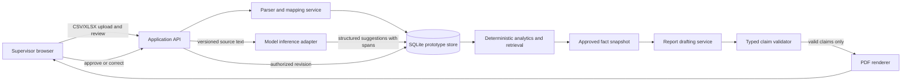

# Proposed system architecture

This describes a target design. No application services or model are implemented in this repository yet.

## Component flow

A server-side adapter owns model credentials and inference connectivity. Browser code never receives provider secrets. The API and database hold authorization and audit boundaries; deployment-specific identity/access controls must be selected before real data is used.

## Proposed technology boundaries

| Area | Proposed choice | Status and constraint |
|---|---|---|
| Tabular parsing | Python, pandas, openpyxl | Proposal; limits, formulas, encodings, and malformed rows need implementation tests |
| Prototype persistence | SQLite | Proposal for a single-user/demo process; concurrent multi-user production requires a new storage decision |
| Adaptation | PyTorch, PEFT LoRA | Proposal; depends on data rights, GPU availability, and actual ROCm compatibility |
| Serving | vLLM on ROCm / MI300X if available | Candidate; validate image, model, adapter loading, JSON constraints, memory, and latency |
| Browser and API | React/TypeScript with Vite client; FastAPI REST service | Provisional recommendation: typed interactive review UI plus Python-native ingestion/model stack; validate with a small workflow spike before committing |
| PDF | ReportLab | Proposal; render and inspect generated pages before release |

The inference worker must be replaceable by deterministic fixture/offline replay so ingestion, review, analytics, and reporting can be exercised without GPU access. A live few-shot LLM path is a distinct, nondeterministic model baseline and must be identified as such. CPU work includes parsing, approval state, counts, joins, validation, PDF generation, and in-memory vector retrieval. GPU work includes model inference, embedding generation, and optional training.

## Proposed API and job workflow

The API is the only component allowed to change approval state; the browser never writes directly to storage. A provisional REST surface is:

- `POST /api/v1/imports` validates an upload and creates an import job; `GET /api/v1/imports/{id}` reports parse/mapping status.
- `PUT /api/v1/imports/{id}/mapping` submits a reviewed mapping revision.
- `POST /api/v1/imports/{id}/extractions` starts an idempotent extraction batch; `GET /api/v1/jobs/{id}` reports per-record progress and retryable failures.
- `PUT /api/v1/annotations/{id}` records a correction; `POST /api/v1/annotations/{id}/approve` and `/reject` perform attributed review transitions with optimistic revision checks.
- `POST /api/v1/snapshots` builds an immutable snapshot from explicitly selected approved revisions; `GET /api/v1/snapshots/{id}` returns scope and build status.
- `POST /api/v1/reports` drafts from a snapshot; `GET /api/v1/reports/{id}` returns draft/validation/render state; `GET /api/v1/reports/{id}/pdf` serves only a completed, validated artifact.

Every write requires authentication/authorization in a real deployment, carries a request and actor ID, validates an idempotency key where retries can occur, and returns a durable job or revision ID. The target statuses are `queued`, `running`, `needs_review`, `approved`, `failed_retryable`, `failed_terminal`, and `superseded`; transition rules must be enforced server-side. A snapshot/report request with no approved records or stale revisions fails with a clear error. API readiness and model readiness are exposed separately; model unavailability does not disable mapping review or deterministic analytics.

## Core records and contracts

- `SourceFile`: id, original filename, content hash, upload actor/time, parser version, retention state.
- `SourceRecord`: stable id, source file id, sheet/row or record key, raw field values, normalized field references.
- `MappingRevision`: source file id, proposed and approved column mapping, editor, timestamp, revision, mapping status.
- `ExtractionSuggestion`: source record id, model/version, task, label, exact source text, character offsets, nullable confidence, confidence method/calibration version if known, creation time.
- `ReviewedAnnotation`: suggestion or manual origin, label, span, status, reviewer, timestamp, revision, correction reason.
- `ApprovedFactSnapshot`: immutable snapshot id, included approved record/revision IDs, query and taxonomy versions, deterministic fact rows, creation actor/time.
- `ReportClaim`: claim id, typed value/unit/time scope/grouping, exact fact snapshot and fact-row IDs, rendered text slot, validation state.

Every generated annotation must reference its source record and exact source span. Offsets are defined against a versioned normalized text representation, while raw text remains available. Model output is untrusted input: schema, label set, offsets, and text-span equality are validated before persistence.

## Review, revisions, and invalidation

Mapping and annotation edits create revisions; they do not erase prior audit history. A report is tied to one immutable approved snapshot. If a mapping or reviewed annotation changes, affected analytics are recomputed into a new snapshot; prior reports remain associated with their original snapshot and are marked superseded where appropriate. Approval is explicit and attributable. Reprocessing is idempotent for the same file hash, parser version, mapping revision, and model/version inputs, while a deliberate rerun receives a distinct run identity.

The UI must distinguish proposed, corrected, approved, rejected, and stale records. A failed model call cannot silently leave a record appearing complete. Partial batch failures are reported per record and can be retried without duplicating approved annotations.

## Analytics, retrieval, and report safety

Counts are deterministic queries over the same approved record set used to create the report snapshot. Related-work-order retrieval uses embeddings generated from approved records, with the index frozen and versioned against the snapshot, embedding model, normalization, and distance/search configuration. Run vector retrieval on CPU in memory from that fixed index. Similarity search is approximate/ranked retrieval, not an exact count or proof that records are equivalent; returned results retain source IDs and similarity scores, and report them separately from deterministic totals. Any index rebuild creates a new index revision tied to its input snapshot.

The draft model receives only the deterministic fact table and permitted retrieved citations, not an unrestricted database query channel. Each quantitative claim is represented as typed data and bound to fact IDs plus the relevant entity, metric, unit, grouping, and time scope. Render quantitative prose from deterministic templates populated by validated typed fields, including spelled-out quantities. Reject arbitrary numeric assertions in free-form narrative unless converted to and validated as typed claims. Token equality alone cannot establish truth: the validator must check that the referenced fact supports the claim's entity, metric, unit, grouping, and time scope before PDF rendering.

The final PDF records the approved snapshot identifier and supporting source-record references. If validation, snapshot generation, or rendering fails, no final report is marked approved; provide a clear error and preserve the draft for correction.

## Failure and operating boundaries

Use request/run IDs and explicit status transitions for uploads, extraction batches, snapshot builds, and report jobs. Enforce upload size/format limits, transaction boundaries for approval, and retry-safe job identifiers when these paths are implemented. A GPU timeout or unavailable endpoint must not block manual review or deterministic analytics. Do not claim streaming or production-scale throughput from a prototype.

Secrets belong in server-side deployment configuration. Logs should use identifiers and bounded diagnostics rather than raw work-order text. Retention, deletion, authentication, authorization, encryption, backups, and multi-user isolation require concrete choices before handling operational data. The baseline repository check workflow validates configuration and document links only; it deliberately performs no security scanning.

## Thermal and prediction boundary

Thermal image ingestion, heat-map anomaly scoring, and later failure prediction are separate future subsystems. Add them only with authorized, labeled thermal data and an asset/time-held-out validation design. A heat-map score is not a confirmed failure and is not linked to a work order without reviewed evidence. Predictive claims need outcome labels and their own time-aware evaluation; they cannot be inferred from anomaly detections alone.

## Evaluation, release, and delivery sequence

For extraction changes, freeze dataset and model revisions; run schema/offset/span validity tests; evaluate entity span and relation measures on train/validation while tuning; preserve the published test set for final evaluation; report taxonomy projection separately with per-class results and uncertainty. Never train, tune, or create pseudo-labels from test records. For vector retrieval, use adjudicated relevant-record queries and report recall@k/precision@k and latency against the versioned index; do not present retrieval similarity as factual correctness. For reporting, test both supported and adversarial claims, including wrong entity, wrong unit, shifted time window, conflicting grouping, spelled-out numbers, unsupported values, and numbers that happen to occur in an unrelated fact. Any unresolved claim must block final output.

Delivery sequence: (1) agree data rights, sample fields, and manual review policy; (2) implement import, mapping, review and audit contracts; (3) exercise deterministic analytics and CPU retrieval with synthetic fixtures; (4) smoke-test the selected ROCm/model/adapter/structured-output stack on the actual host and record cold/warm latency; (5) compare model extraction with a fixture replay and, separately, any live few-shot model baseline; (6) integrate typed claims, PDF rendering, and failure recovery; (7) run held-out evaluation, inspect the rendered demo, and record exactly which paths and versions were used. All technology choices and acceptance thresholds remain provisional until these checks run.
