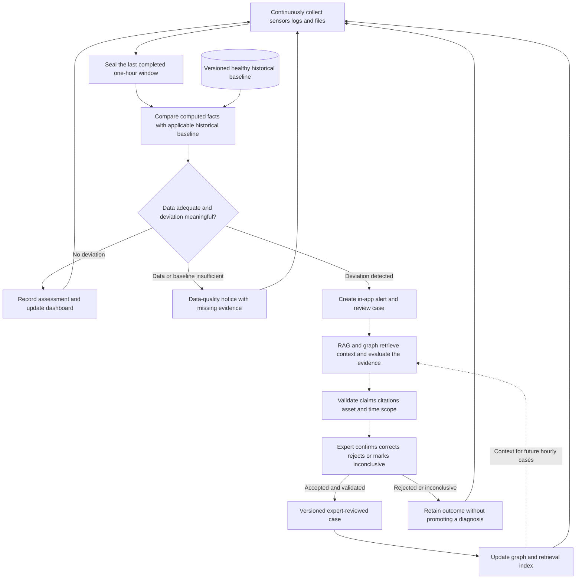
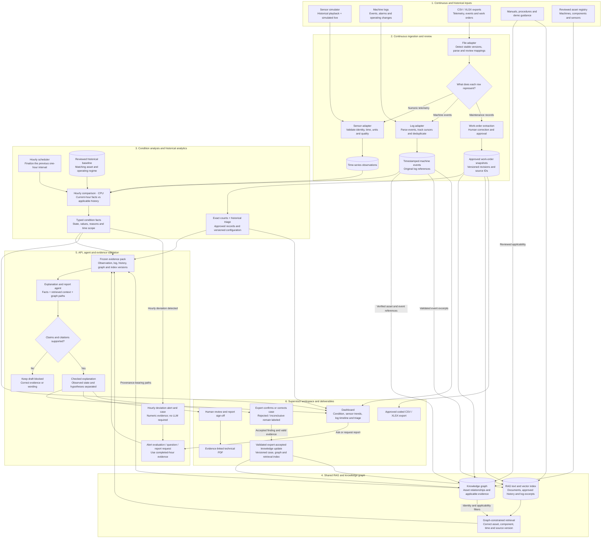
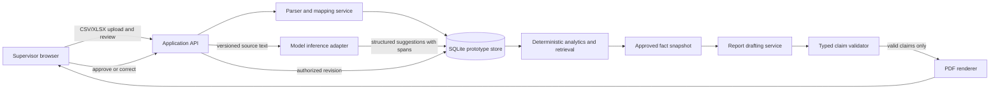

# Proposed system architecture

This describes a target design. No application services or model are implemented in this repository yet.

**New direction, 13 October 2026:** the requested expansion adds problem recognition, validated forecasting, technician/resource matching, loss-aware scheduling and verified maintenance outcomes. See the [detailed maintenance direction and implementation plan](MAINTENANCE_DIRECTION.md) for the proposed extension and revised interactive walkthrough. The sections below retain the evidence/hourly-monitoring foundation; earlier prediction exclusions describe the previous scope and continue to prohibit unsupported predictive claims.

## Simplified high-level architecture and fine-tuning role - October 14, 2026

The user confirmed this as the new proposed-system direction on 14 October 2026. The high-level view is reduced to eleven parts in three loops, and fine-tuning is given an explicit role. The [high-level walkthrough](../artifacts/ignis-high-level-architecture.html) animates this view. The [complete workflow and comparison](PROPOSED_SYSTEM_WORKFLOW.md) explains the operating sequence, authority, tradeoffs and acceptance criteria; the [hospital analogy](../artifacts/ignis-architecture-explained.html) explains the same design. The [detailed 36-block map](../artifacts/ignis-data-flow.html) predates fine-tuning and is not updated. All of this remains proposed; no model has been trained. Earlier scopes, schedules and fallback suggestions are historical where they conflict with this section.

| Loop | Parts |
|---|---|
| Monitor, once per completed hour | Sources → Ingest & review → Trusted data → Hourly check → Evidence & explanation → Reports |
| Respond, human-approved | Incident & expert → Match & dispatch → Repair & verify → Learn & publish → back to Trusted data |
| Improve, offline | Fine-tuning & model release: curate dataset → fine-tune → evaluate → approve and register |

### Where the fine-tuned model is used

One open base model carries two LoRA task adapters:

1. **Extraction adapter, in Ingest & review.** It proposes component, fault and action spans from work-order text as strict JSON with exact offsets. A supervisor approves, corrects or rejects every suggestion. If the adapter is unavailable, review is manual.
2. **Reasoning adapter, in Evidence & explanation.** It reads a frozen evidence pack (condition facts, retrieved passages, graph paths) and returns structured hypotheses that each cite evidence IDs, stated uncertainty, a suggested inspection, or an explicit abstention. The claim checker still validates every number, asset and time scope. It may also draft report narrative; report numbers render from typed facts.

Fine-tuning teaches task format, maintenance vocabulary, citation discipline and abstention. It does not store plant facts: current evidence still comes from retrieval and the graph, and code still computes every measurement, forecast, count and schedule. The model never approves, books, publishes or controls equipment.

### Training data and release gate

- **Data:** MaintIE train and validation splits for extraction, with its published test split untouched. Approved work-order annotations can supplement extraction; expert-reviewed cases supply reasoning examples, including rejected and inconclusive cases labelled as such so the model learns to abstain. The first demonstration uses synthetic cases. Each dataset is frozen as a version. Preserve MaintIE's published splits; use asset/time holdouts for additional asset-linked product cases and keep related incidents or reformatted copies together. Do not invent asset metadata for MaintIE.
- **Method:** supervised fine-tuning with LoRA on a 7–8B open instruct model. The base model is not selected. The proposed hardware is an AMD MI300X with ROCm and vLLM adapter serving, only if access and compatibility are confirmed by an actual smoke test.
- **Release:** compare each adapter with the untuned base model on held-out data. Extraction is scored on span F1 and schema validity. Reasoning is scored on citation accuracy, unsupported-claim rate and correct abstention. Release only if the adapter beats the baseline without regressing on safety checks. Training loss alone never qualifies. The model owner approves each release; the registry records base model, adapter, dataset version, metrics and a rollback target.
- **Cadence:** a deliberate cycle, run when enough new reviewed cases exist. Publishing a case makes it retrievable immediately but never starts training. Training never runs per hourly alert, and unverified outcomes are never used as training data.

### Changes from the 13 October drafts

- The 16 runtime components and three separate fine-tuning modules are merged into eleven parts. The fine-tuning cycle is one block with four internal steps.
- The optional numeric model/rule approval path is folded into the same release block, as a dashed, separately approved output to the hourly check.
- The fine-tuned model is **not required** to release an alert. If the reasoning adapter is unavailable, the numeric alert and the evidence pack still reach the expert without a drafted explanation, and the base model is not silently substituted.
- The earlier, more detailed fine-tuning draft of this page is archived as [ignis-high-level-architecture-finetuning-draft-2026-10-14.html](../artifacts/ignis-high-level-architecture-finetuning-draft-2026-10-14.html).

## Sensor-informed RAG and knowledge-graph revision - October 13, 2026

### Confirmed direction and recommendations

The user requires sensor information, historical and live-style operation, and RAG plus a knowledge-graph approach to improve machine-state assessment. The demonstration will simulate both historical observations and a live stream because no factory connection is available. KAG means knowledge-graph-assisted reasoning here; a particular framework such as OpenSPG is not selected. This scope revision supersedes the earlier text-only boundary for the simulated demonstration. Persistent agent instructions are not changed.

Recommended first asset: one motor-driven pump. Simulate bearing temperature (degC), vibration RMS (mm/s) and motor current (A), with speed (rpm), load (%) and operating mode as context. Vibration RMS is an aggregate input, not an implemented waveform analysis. These choices are design recommendations. The simulator, condition engine, graph, retrieval and UI are not built. All demonstration readings, work orders, asset links and fictional operating guidance must be labeled synthetic.

### Hourly assessment and expert-confirmed knowledge growth

**Confirmed cadence:** continuously collect sensor readings, machine logs and completed CSV/XLSX updates; assess machine condition once each hour using the last completed one-hour interval. This replaces the earlier proposal to initiate automatic condition assessments on every relevant state change. Questions and reports can still use the latest completed assessment and its pinned evidence without initiating an extra automatic condition evaluation.

For example, the 10:00 Bangkok assessment covers `[09:00, 10:00)`. Store timestamps with an explicit timezone/UTC representation, use event time for selection, and expose the evaluated interval, source freshness and as-of time. The finalization grace period, coverage requirement and late-event correction policy remain implementation decisions. Reprocessing a completed hour creates a linked revision, not an extra unrelated alert. Historical replay uses the same hourly intervals on an explicitly labeled accelerated simulation clock.

The following is the normative feedback loop; the larger component diagram below supplies its ingestion, storage, retrieval and report infrastructure.

1. **Collect continuously.** Keep raw observations and event references while preserving the existing maintenance-record mapping/extraction/review workflow. Collection does not require an LLM call and does not establish a fault.
2. **Compare hourly.** Compute features over the complete hour, including trends, extrema, persistence/duration and relevant event counts where supported, rather than relying on one mean that can hide a short excursion. Compare with a versioned baseline for the same machine/component, signal units, speed/load/operating regime and effective asset configuration. The baseline uses explicitly eligible earlier normal/accepted windows and excludes the current hour, known abnormal intervals, rejected/bad sensor data and future information. Which features, deviation rules, minimum baseline history and sensitivity to use are proposed configuration choices, not validated industrial thresholds. Domain-approved absolute operating limits remain a separate check; historically abnormal operation must not become healthy merely because it repeats.
3. **Alert before model evaluation.** A deterministic deviation decision creates an in-app alert/case containing asset, interval, measured features, baseline/rule version, differences, source IDs and data quality. The alert means deviation requiring review, not confirmed failure. Missing observations or a missing applicable baseline produce an explicit insufficient-data/baseline notice rather than a healthy result or invented anomaly. Alert creation continues if the LLM is unavailable. External delivery channels are not selected or configured.
4. **Evaluate with RAG and the graph.** Freeze the hourly evidence pack; retrieve applicable guidance, prior approved work orders, log excerpts and expert-accepted cases. Draft possible explanations, supporting and conflicting evidence, and uncertainties. Validate numeric comparisons, identities, time scopes and citations before presenting the explanation as checked. Failed model evaluation leaves the numeric alert and expert review available; an unchecked diagnosis cannot become knowledge.
5. **Obtain expert confirmation.** Record an identified expert's decision, corrected finding, reason, exact supporting evidence, applicable operating conditions, timestamp and revision. Outcomes are `confirmed`, `corrected`, `rejected` or `inconclusive`; acknowledgement of an alert is not diagnosis confirmation. An expert may confirm abnormal condition while leaving its cause unknown. That limited finding is recorded without inventing a cause. Expert-reviewed conclusions are attributed findings with their original evidence, not universal causal rules.
6. **Expand knowledge only after validation.** Confirmed or corrected, accepted case findings become versioned `ReviewedCase` records; add their supported graph links and searchable case summaries through an idempotent update job. Check that the reviewed evidence resolves to the proper versions, machine/time scope and graph schema; publish a new graph/index revision together, or keep the prior retrieval view active if publication fails. Rejected/inconclusive outcomes remain in the audit/evaluation ledger and may supply clearly labeled negative/uncertain examples, but are never indexed as confirmed faults. Repeated hourly windows from one continuing incident link to the same review case rather than inflating independent case counts. A materially new incident can open a separate case.

Knowledge growth means adding reviewed evidence, cases and relationships for future retrieval. It does not automatically retrain model weights, change thresholds or promote an abnormal window into the normal baseline. Any baseline/rule update is a separate explicit, attributed approval with a new version/effective time; prior assessments and issued reports keep their original evidence. Expert corrections/retractions supersede prior case versions and propagate to later retrieval revisions without erasing audit history.

Candidate contracts: `HourlyAssessment` (asset, interval, feature/observation/event references, quality, baseline/rule/config versions, result and revision); `BaselineSnapshot` (eligible historical window IDs, operating regime, feature definitions, scope, approval and version); `AlertCase` (assessment IDs, incident identity, reason, state and deduplication key); `ExpertReview` (expert, outcome, reason, finding scope, evidence IDs and revision); `ReviewedCase` (accepted attributed findings, provenance, applicability, synthetic flag and supersession); and `KnowledgeUpdateJob` (review revision, idempotency key, previous/new graph/index versions and publish status). Model tools remain read-only. Authenticated application services perform case review and knowledge publication through revision-checked writes; there is no autonomous model write path.

Proposed demo: start with reviewed, labeled synthetic healthy history; stream a fictional one-hour interval with elevated temperature/vibration and linked log events; advance the simulation clock to the boundary; show the alert, comparison and checked retrieval explanation; have the expert accept or correct the case; show a new knowledge revision available to a later similar hourly case. Also demonstrate an inconclusive/rejected outcome and sensor dropout, neither of which creates confirmed-fault knowledge. This is a future application workflow. No hourly process, alerts, external messages, expert portal, case publisher, model training or Codex automation has been started by these document edits. The existing animated HTML illustrates the preceding flow and does not yet demonstrate this hourly feedback loop.

### Continuous multi-source inputs and refresh

The user further confirmed that this is one combined system: continuously read machine logs and incoming or updated CSV/XLSX exports alongside sensors, preserving the previous work-order extraction/review/report workflow. A format is not a domain: a CSV/XLSX row may contain numeric telemetry, a machine event or a maintenance record. Reviewed source mappings classify and route rows to the appropriate pipeline; never send all spreadsheet rows through component/fault/action extraction.

The first demonstration uses synthetic machine logs and a watched or polled demo export location, not a factory network. Start with a bounded scheduled poll or local file watcher; its interval and source adapters remain configurable. Sensors append observations; log readers checkpoint source identity/offset and handle rotation; file readers wait for a stable/complete version before parsing. Archive the original source version, content hash, locator, event time, ingestion time and parser/mapping version. Partial writes are retried without importing an incomplete workbook. Same-content rereads must be idempotent; changed work-order rows create revisions using stable source keys rather than duplicate approved records. A replaced file is not a command to erase older evidence.

Validate event timestamps, event types/codes and asset identity independently of any model interpretation. Parsed events can appear as observed log facts without manual approval of every event; model-suggested fault diagnoses or graph relationships remain unreviewed until accepted. New or changed maintenance annotations still require human review before entering approved historical counts or triage. Logs, sensor observations and work orders keep distinct record types even when they share an asset/time scope.

Append observations/events and refresh raw charts as data arrives. Run condition/baseline evaluation once each hour on the finalized previous hour, as specified above. Refresh retrieval indexes and approved graph views incrementally by source revision; expose ingestion/index lag and as-of times. The dashboard shows both current raw readings and the explicitly time-scoped latest hourly assessment; it cannot present a stale assessment or contextual output as a fresh checked evaluation. Questions can explain an existing hourly evidence pack; do not call an LLM for every reading or reread every workbook for every query. No queue broker or external integration is selected yet.

### Combined component flow

The condition service establishes numeric facts and rule-derived state. RAG retrieves applicable documents and approved history. The graph resolves machine/component/sensor identity, relationships and rule applicability. The LLM explains the evidence and can propose labeled hypotheses; it cannot rewrite readings, invent limits, change graph links or replace calculations. This is a proposed condition-assessment architecture, not a validated diagnostic capability.

### Stage-by-stage operation

| Stage | Processing | Output and boundary |
|---|---|---|
| Prepare demo | Seed fictional assets, reviewed sensor mounting, operating profiles, documents and linked historical work orders | Versioned scenario; generator ground-truth labels held separately for evaluation |
| Ingest observations | Historical replay and simulated live emit one schema; validate identity, time, units, finite values, quality and duplicates | Append-only time-series observations; invalid rows rejected; gaps preserved |
| Read logs and exports continuously | Checkpoint appended/rotated logs; detect stable CSV/XLSX versions; review mappings and route telemetry, events and maintenance rows | Preserved source/event references; idempotent refresh; changed maintenance annotations await review |
| Analyze condition hourly | Seal the last completed one-hour window; check quality/regime; compare exact features with eligible historical baseline and applicable operating limits | Typed hourly facts; deviation alert or explicit insufficient-data/baseline status; no LLM needed for comparison |
| Resolve graph | Traverse sensor -> component -> machine; obtain applicable limits/document versions and reviewed work-order links | Provenance-bearing paths scoped to asset and effective time |
| Retrieve evidence | Use graph-derived asset/model/component applicability to filter before keyword/vector ranking | Cited passages and similar approved records; similarity does not establish diagnosis |
| Freeze evidence | Pin observation windows, condition/config versions, approved work-order snapshot, graph/index/document revisions and as-of time | Reproducible evidence pack; later readings cannot modify an issued report |
| Explain and validate | Model drafts from bounded facts/citations; validator checks values, units, scope, graph paths and cited wording | Separate observations, derived state and hypotheses; unsupported certainty blocked |
| Review and report | Supervisor reviews explanation and signs off; retain reviewer and revisions | PDF with both sensor-window and work-order evidence; no equipment control |

### Sensor data and state contracts

`SensorObservation` carries observation/sensor/asset IDs, event time, ingestion time, signal, finite value, unit, quality, synthetic source mode, and simulator seed/scenario version. Keep sensor identity and mounting in the reviewed registry; never infer them from text similarity. Windows carry interval, observation IDs, coverage/freshness, operating regime and finalization/revision state. Condition facts carry metric/value/unit, window and observation references, feature/rule/profile versions, label and reasons.

`MachineEvent` carries event/asset IDs, source identity and locator/offset, original message, parsed event code/type, reported severity as source metadata, event/ingestion time, parser version, quality and simulation mode. `SourceCursor` tracks a log offset/rotation generation or an imported file hash/version plus stable row keys, mapping revision and checkpoint. Model-derived event meaning is separate from the observed message. Sensor and log facts may contribute to a condition rule only when it explicitly defines their time/asset/operating-profile scope; a log alarm is not automatically a confirmed machine fault.

Proposed display labels: `within_demo_limits`, `elevated_signals`, `insufficient_data`; show operating mode separately. Within limits means only that observed signals satisfy the applicable demo profile in that window. Missing/stale data, inadequate coverage, unresolved identity or no applicable operating profile produce insufficient data, not a healthy label. An abnormal reading is not a confirmed fault or predicted failure.

Each limit profile includes machine/component/signal scope, unit, load/speed regime, effective interval, version, provenance and reviewer. Start with deterministic rules. Learned anomaly/condition models remain optional candidates requiring separate evaluation. Raw numeric samples stay in time-series storage; tools supply exact window facts. Indexed text summaries, if added, never replace the authoritative observations.

### Historical and simulated-live modes

Use the same seeded simulator and contracts in both modes. The confirmed assessment cadence/window is once per hour over the previous completed one-hour interval. Proposed demo sampling is one observation per second per signal; optional 60-second feature buckets may summarize trends within that hour, but do not trigger extra condition assessments. A 10-second ingestion-freshness limit is a proposed demo setting distinct from coverage of a historical hour. Sampling, bucket size, quality thresholds and late-event policy remain configuration decisions, not industrial requirements. Accelerated playback exposes its multiplier and uses a simulation clock so historical event timestamps are not incorrectly judged stale against wall-clock time.

The simulated-live view appends observations and refreshes raw charts continuously; condition comparison and automatic alert evaluation occur on hourly boundaries. Historical mode analyzes or replays fixed hourly intervals through the same engine. Deduplicate stable observation IDs, preserve event/ingestion time, and finalize windows explicitly. Late corrections create new evidence revisions rather than silently changing reports. No MQTT, OPC UA, PLC, factory network or hardware is needed for the first demo; a simulator-to-API adapter suffices. Model live/replay/fixture mode is labeled independently: a live LLM does not make synthetic sensor data real.

### RAG and knowledge graph

Index approved work orders, fictional demo guidance and later authorized manuals/procedures, preserving document/version/page/span, rights, synthetic status and asset/model applicability. Proposed nodes are `Machine`, `Component`, `Sensor`, `ObservationWindow`, `ConditionFact`, `LimitProfile`, `WorkOrder` and `DocumentChunk`. Edges include `HAS_COMPONENT`, `INSTALLED_ON`, `MEASURES`, `OBSERVED_IN`, `SUPPORTED_BY`, `APPLIES_TO` and `MAINTENANCE_FOR`. Every edge carries provenance, revision and an effective interval where relevant. Document-extracted edges remain suggestions until reviewed; conflicting facts remain visible.

Example: `PUMP-01 -> HAS_COMPONENT -> BEARING-01 <- INSTALLED_ON <- SENSOR-TEMP-01`. Graph traversal identifies the measured component and applicable limit/document profile before retrieval. An unrelated pump manual cannot become this pump's limit simply because its wording is similar. A work-order link requires explicit asset/time/source evidence; temporal coincidence is not proof that maintenance caused a sensor event.

Begin with one logical graph and one hybrid retrieval pipeline. Relational node/edge tables and bounded typed traversal are a proposed simple demo implementation; a dedicated graph database or OpenSPG KAG is an alternative if a spike demonstrates a needed capability. Do not claim a lightweight graph-aware implementation reproduces the OpenSPG framework or its benchmarks. Framework/store selection remains open.

MaintIE remains useful for text extraction, but cannot be fabricated into asset/time-linked sensor history. For the integrated demo, create synthetic work orders with explicit fictional asset IDs and timestamps. Historical component triage from the downloaded proposal and recent sensor condition are different measures: show them separately with their own versions/as-of times. Combining them into a new priority score requires an explicit definition and evaluation.

### Tools, snapshots and report validation

Candidate read-only tools: `get_sensor_window`, `get_machine_events`, `get_condition_facts`, `get_asset_context`, `query_graph`, `search_applicable_documents`, and `search_approved_work_orders`, alongside existing count/report tools. Exact event counts come from code over selected validated events, separately from approved maintenance counts. Every call is asset/time/version scoped, schema checked and bounded. The model has no write access to observations, rules, graph identity or review state.

An `EvidencePack` pins observation/window/fact IDs, selected machine-event IDs/log cursor/source versions and a source cutoff/as-of time; approved work-order snapshot; graph/index/document/rule/config revisions; and synthetic/model modes. Every selected reference must resolve to the pinned revision and allowed scope. Newly arrived logs or corrected spreadsheets affect a later pack, never an issued report. `StateAssessment` keeps observations, computed condition and cited hypotheses distinct, with reviewer/status/revision and no invented confidence probability. Sensor observations and parsed log events need integrity/quality checks rather than manual approval of every sample; work-order annotations, graph/profile configuration and issued reports retain human review.

Candidate API additions: `GET /api/v1/assets/{id}/condition`, `GET /api/v1/assets/{id}/sensor-windows`, `POST /api/v1/assessments`, and `GET /api/v1/assessments/{id}`. A server-side simulator ingestion adapter is also needed; protocol details remain provisional. A model outage preserves ingestion, condition calculations and review; unavailable narration is reported explicitly.

For the hourly feedback loop, candidate reads expose completed-hour assessments, baseline versions, alert cases and knowledge revisions. Candidate revision-checked writes record `POST /api/v1/alert-cases/{id}/reviews` and start a knowledge update from an accepted review. Exact endpoints and authorization policy remain provisional; the model cannot invoke review/knowledge-publish writes as an expert. Normal alerts, expert case confirmation, maintenance annotation approval and report sign-off are distinct states/actions.

Extend typed claim validation to sensor-window scope, units and profile applicability. Check whether cited text actually supports the explanatory wording: a valid number or graph path alone is not causal proof. Unsupported diagnosis certainty, repair prescriptions, remaining-useful-life estimates, failure probabilities and equipment-control commands remain outside scope. An insufficient-data window may be reported as such but must not be described as healthy. Human approval is required before issuing reports.

### Worked example and judge demonstration

All following values and limits are fictional demo fixtures, not measurements or equipment guidance. At a configured steady speed/load, `PUMP-01` has a complete one-hour window for all required signals, with mean bearing temperature 80 degC and mean vibration RMS 6 mm/s. Matching `DEMO-PROFILE-v1` limits are 70 degC and 4 mm/s. Code computes exceedances of 10 degC and 2 mm/s. An eligible synthetic healthy baseline has mean temperature 60 degC; fictional reviewed comparison rule `DEMO-COMPARE-v1` flags a mean rise greater than 15 degC, so the 20 degC rise creates an hourly deviation alert. These rules do not diagnose bearing failure. Expert-accepted case evidence can expand future retrieval knowledge, while baseline/rule changes require their own explicit approval.

The graph links the sensors to `BEARING-01` in `PUMP-01`, finds applicable synthetic guidance, and retrieves that asset's approved synthetic bearing work order. A checked explanation can state that the simulated window exceeds its configured limits, quote guidance describing possible bearing-condition indicators, and say that the cause needs confirmation. Each number, limit, passage, graph path and work-order ID is inspectable; an unsupported prediction that the pump will fail tomorrow is blocked.

Recommended presentation:

1. Show historical baseline readings, the synthetic label and sensor-to-component registry/graph paths.
2. Switch to the labeled simulated-live stream; show gradual elevated signals and the completed-window assessment.
3. Ask why condition changed; display exact facts, applicable document passages and graph-constrained historical evidence.
4. Switch to high load with its own demo profile, distinguishing a context-appropriate increase from the elevated-signal case. If no matching profile exists, show insufficient data.
5. Simulate sensor dropout; show missing/stale observations and insufficient data, preserving gaps.
6. Review and issue an evidence-linked report; replay the same seed/window and reproduce deterministic facts. Live model wording is not claimed deterministic.
7. Append a synthetic machine event and replace a CSV/XLSX export with one changed maintenance row. Show checkpointed refresh without duplicate counts; approve the changed annotation, then build new history/graph/index revisions and a new explanation while the previous issued report retains its old evidence.

### Implementation and verification boundaries

Build simulator/registry and observation validation first, then windowed rules/evidence versions, then reviewed graph paths and applicable retrieval, then explanation/checking/UI/report integration. CPU handles ingestion, storage, rules, graph traversal, retrieval search, validation and PDF generation. Confirmed GPU capacity may run embeddings/LLM inference and optional adaptation; no actual AMD deployment or compatibility is established.

Required checks: historical/live parity for identical finalized windows; exact aggregates/units/comparisons; duplicate/late/stale-data handling; correct profile selection; exclusion of wrong-asset records/documents; and full observation-to-report provenance. Compare text-only and graph-constrained retrieval on judged questions. Evaluate synthetic scenario detection separately from explanation quality, keep simulator labels inaccessible to inference, and measure unsupported-claim rate, retrieval relevance and latency before reporting results. Synthetic success does not establish factory diagnostic accuracy. Existing extraction test-split rules still apply.

Hourly-learning checks must cover exact hour/timezone boundaries and catch-up after restart; no extra automatic condition assessments between boundaries; prior-only regime-matched baseline selection; incomplete hour/baseline notices; deterministic deviation alerting without a model; deduplication of continuing incidents; accepted/corrected/rejected/inconclusive expert outcomes; revision conflicts; idempotent case publication; joint graph/index visibility and rollback; no promotion of pending/rejected diagnoses; isolation of baseline changes from case learning; and reproducible old evidence after retraction. A later assessment should retrieve an accepted applicable case and exclude its superseded version. These are acceptance criteria, not executed application tests.

Continuous-source checks additionally cover partial workbook writes, repeated same-content polls, changed/deleted source rows without audit erasure, rotated/truncated logs, checkpoint restart, mixed telemetry/event/maintenance spreadsheet routing, and graph/index lag. Reprocessing the same inputs must not inflate counts, auto-approve new annotations or silently relink assets. Confirm dashboard freshness independently from model availability and freeze all source versions for reproducible issued reports. These are future product checks; repository link/configuration checks do not establish this behavior.

Confirmed: continuous collection, once-hourly condition comparison and expert-gated case knowledge growth. Open decisions: graph framework/store; deployed model/runtime; sampling/feature buckets/coverage/finalization policies; baseline eligibility/history minimum and deviation sensitivity; operating profiles; expert roles and alert delivery channels; data rights and real integration; and adoption of the separate Evolus draft. The downloaded triage files, tldraw board and animated HTML describe preceding designs; these local document edits do not revise those artifacts.

References: [RAG design and evaluation](https://learn.microsoft.com/en-us/azure/architecture/ai-ml/guide/rag/rag-solution-design-and-evaluation-guide), [OpenSPG KAG](https://github.com/OpenSPG/KAG), [KAG paper](https://arxiv.org/abs/2409.13731), and [NIST monitoring, diagnostics and prognostics](https://www.nist.gov/programs-projects/monitoring-diagnostics-and-prognostics-manufacturing-operations). These support the pattern distinctions, not this prototype's machine-state accuracy.

## Historical text baseline component flow

A server-side adapter owns model credentials and inference connectivity. Browser code never receives provider secrets. The API and database hold authorization and audit boundaries; deployment-specific identity/access controls must be selected before real data is used.

## Proposed technology boundaries

| Area | Proposed choice | Status and constraint |
|---|---|---|
| Tabular parsing | Python, pandas, openpyxl | Proposal; limits, formulas, encodings, and malformed rows need implementation tests |
| Prototype persistence | SQLite | Proposal for a single-user/demo process; concurrent multi-user production requires a new storage decision |
| Adaptation | PyTorch, PEFT LoRA | Proposal; depends on data rights, GPU availability, and actual ROCm compatibility |
| Serving | vLLM on ROCm / MI300X if available | Candidate; validate image, model, adapter loading, JSON constraints, memory, and latency |
| Browser and API | React/TypeScript with Vite client; FastAPI REST service | Provisional recommendation: typed interactive review UI plus Python-native ingestion/model stack; validate with a small workflow spike before committing |
| PDF | ReportLab | Proposal; render and inspect generated pages before release |

The inference worker must be replaceable by deterministic fixture/offline replay so ingestion, review, analytics, and reporting can be exercised without GPU access. A live few-shot LLM path is a distinct, nondeterministic model baseline and must be identified as such. CPU work includes parsing, approval state, counts, joins, validation, PDF generation, and in-memory vector retrieval. GPU work includes model inference, embedding generation, and optional training.

## Proposed API and job workflow

The API is the only component allowed to change approval state; the browser never writes directly to storage. A provisional REST surface is:

- `POST /api/v1/imports` validates an upload and creates an import job; `GET /api/v1/imports/{id}` reports parse/mapping status.
- `PUT /api/v1/imports/{id}/mapping` submits a reviewed mapping revision.
- `POST /api/v1/imports/{id}/extractions` starts an idempotent extraction batch; `GET /api/v1/jobs/{id}` reports per-record progress and retryable failures.
- `PUT /api/v1/annotations/{id}` records a correction; `POST /api/v1/annotations/{id}/approve` and `/reject` perform attributed review transitions with optimistic revision checks.
- `POST /api/v1/snapshots` builds an immutable snapshot from explicitly selected approved revisions; `GET /api/v1/snapshots/{id}` returns scope and build status.
- `POST /api/v1/reports` drafts from a snapshot; `GET /api/v1/reports/{id}` returns draft/validation/render state; `GET /api/v1/reports/{id}/pdf` serves only a completed, validated artifact.

Every write requires authentication/authorization in a real deployment, carries a request and actor ID, validates an idempotency key where retries can occur, and returns a durable job or revision ID. The target statuses are `queued`, `running`, `needs_review`, `approved`, `failed_retryable`, `failed_terminal`, and `superseded`; transition rules must be enforced server-side. A snapshot/report request with no approved records or stale revisions fails with a clear error. API readiness and model readiness are exposed separately; model unavailability does not disable mapping review or deterministic analytics.

## Core records and contracts

- `SourceFile`: id, original filename, content hash, upload actor/time, parser version, retention state.
- `SourceRecord`: stable id, source file id, sheet/row or record key, raw field values, normalized field references.
- `MappingRevision`: source file id, proposed and approved column mapping, editor, timestamp, revision, mapping status.
- `ExtractionSuggestion`: source record id, model/version, task, label, exact source text, character offsets, nullable confidence, confidence method/calibration version if known, creation time.
- `ReviewedAnnotation`: suggestion or manual origin, label, span, status, reviewer, timestamp, revision, correction reason.
- `ApprovedFactSnapshot`: immutable snapshot id, included approved record/revision IDs, query and taxonomy versions, deterministic fact rows, creation actor/time.
- `ReportClaim`: claim id, typed value/unit/time scope/grouping, exact fact snapshot and fact-row IDs, rendered text slot, validation state.

Every generated annotation must reference its source record and exact source span. Offsets are defined against a versioned normalized text representation, while raw text remains available. Model output is untrusted input: schema, label set, offsets, and text-span equality are validated before persistence.

## Review, revisions, and invalidation

Mapping and annotation edits create revisions; they do not erase prior audit history. A report is tied to one immutable approved snapshot. If a mapping or reviewed annotation changes, affected analytics are recomputed into a new snapshot; prior reports remain associated with their original snapshot and are marked superseded where appropriate. Approval is explicit and attributable. Reprocessing is idempotent for the same file hash, parser version, mapping revision, and model/version inputs, while a deliberate rerun receives a distinct run identity.

The UI must distinguish proposed, corrected, approved, rejected, and stale records. A failed model call cannot silently leave a record appearing complete. Partial batch failures are reported per record and can be retried without duplicating approved annotations.

## Analytics, retrieval, and report safety

Counts are deterministic queries over the same approved record set used to create the report snapshot. Related-work-order retrieval uses embeddings generated from approved records, with the index frozen and versioned against the snapshot, embedding model, normalization, and distance/search configuration. Run vector retrieval on CPU in memory from that fixed index. Similarity search is approximate/ranked retrieval, not an exact count or proof that records are equivalent; returned results retain source IDs and similarity scores, and report them separately from deterministic totals. Any index rebuild creates a new index revision tied to its input snapshot.

The draft model receives only the deterministic fact table and permitted retrieved citations, not an unrestricted database query channel. Each quantitative claim is represented as typed data and bound to fact IDs plus the relevant entity, metric, unit, grouping, and time scope. Render quantitative prose from deterministic templates populated by validated typed fields, including spelled-out quantities. Reject arbitrary numeric assertions in free-form narrative unless converted to and validated as typed claims. Token equality alone cannot establish truth: the validator must check that the referenced fact supports the claim's entity, metric, unit, grouping, and time scope before PDF rendering.

The final PDF records the approved snapshot identifier and supporting source-record references. If validation, snapshot generation, or rendering fails, no final report is marked approved; provide a clear error and preserve the draft for correction.

## Failure and operating boundaries

Use request/run IDs and explicit status transitions for uploads, extraction batches, snapshot builds, and report jobs. Enforce upload size/format limits, transaction boundaries for approval, and retry-safe job identifiers when these paths are implemented. A GPU timeout or unavailable endpoint must not block manual review or deterministic analytics. Do not claim streaming or production-scale throughput from a prototype.

Secrets belong in server-side deployment configuration. Logs should use identifiers and bounded diagnostics rather than raw work-order text. Retention, deletion, authentication, authorization, encryption, backups, and multi-user isolation require concrete choices before handling operational data. The baseline repository check workflow validates configuration and document links only; it deliberately performs no security scanning.

## Thermal and prediction boundary

Thermal image ingestion, heat-map anomaly scoring, and later failure prediction are separate future subsystems. Add them only with authorized, labeled thermal data and an asset/time-held-out validation design. A heat-map score is not a confirmed failure and is not linked to a work order without reviewed evidence. Predictive claims need outcome labels and their own time-aware evaluation; they cannot be inferred from anomaly detections alone.

## Evaluation, release, and delivery sequence

For extraction changes, freeze dataset and model revisions; run schema/offset/span validity tests; evaluate entity span and relation measures on train/validation while tuning; preserve the published test set for final evaluation; report taxonomy projection separately with per-class results and uncertainty. Never train, tune, or create pseudo-labels from test records. For vector retrieval, use adjudicated relevant-record queries and report recall@k/precision@k and latency against the versioned index; do not present retrieval similarity as factual correctness. For reporting, test both supported and adversarial claims, including wrong entity, wrong unit, shifted time window, conflicting grouping, spelled-out numbers, unsupported values, and numbers that happen to occur in an unrelated fact. Any unresolved claim must block final output.

Delivery sequence: (1) agree data rights, sample fields, and manual review policy; (2) implement import, mapping, review and audit contracts; (3) exercise deterministic analytics and CPU retrieval with synthetic fixtures; (4) smoke-test the selected ROCm/model/adapter/structured-output stack on the actual host and record cold/warm latency; (5) compare model extraction with a fixture replay and, separately, any live few-shot model baseline; (6) integrate typed claims, PDF rendering, and failure recovery; (7) run held-out evaluation, inspect the rendered demo, and record exactly which paths and versions were used. All technology choices and acceptance thresholds remain provisional until these checks run.
