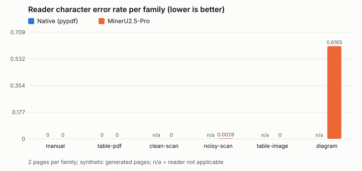
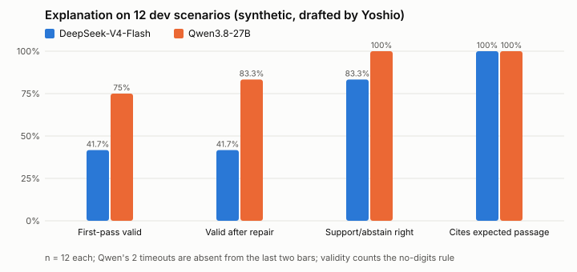
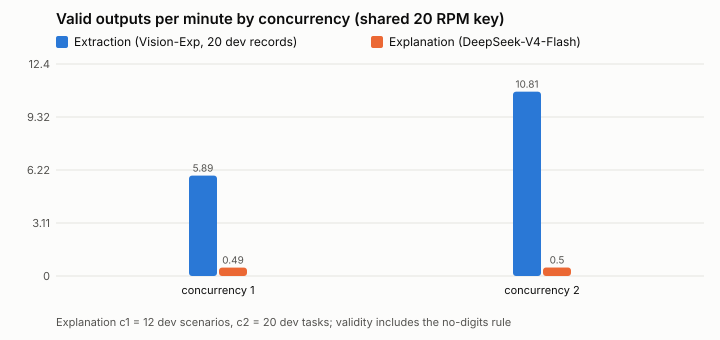

# Hosted model benchmarks for #23

Measured on 2026-10-16 with the event's AMD API and its one shared key (20 requests per minute, $1 per day). Each run happened once, on small sets, so treat every number as preliminary. The explanation scenarios are synthetic: Yoshio drafted them, and they are pending Tuong's review. Every number below is in [results.json](benchmarks/results.json). The inputs and settings are frozen in [manifest.json](benchmarks/manifest.json).

## Summary

| Role | Selected configuration | Evidence | Main limitation |
|---|---|---|---|
| Document reader | Native `pypdf` for text PDFs; MinerU2.5-Pro (`/ocr`) for scans and images ([reader_config.json](../ignis_wo/hosted/reader_config.json)) | Reads text, tables and scans almost exactly on the 12-page pilot | Drops labels inside diagrams |
| Work-order extraction | DeepSeek-V4-Flash-Vision-Exp, frozen few-shot ([extraction_config.json](../ignis_wo/hosted/extraction_config.json)) | All 20 dev records valid at concurrency 1 and 2; 5.9 and 10.8 valid records per minute | Test-split score comes from PR #22 and was not re-run |
| Explanation | DeepSeek-V4-Flash, reasoning `low` ([explanation_config.json](../ignis_wo/hosted/explanation_config.json)) | Support or abstain decision right 10/12 on dev and 7/8 on held-out; p50 about 20 s | Most drafts fail the no-digits rule because they name the model (PX-100) |

Qwen3.8-27B wrote better-formed drafts but was too slow for an interactive demo. It timed out at the 180 s client limit on 2 of 12 dev and 4 of 8 held-out scenarios, and its median was over 100 s.

## Stage 0: compatibility screen

- **Catalogue:** 14 models listed, including MinerU2.5-Pro.
- **Probes:** one MinerU page and one minimal JSON call each to DeepSeek-V4-Flash and Qwen3.8-27B, with `max_tokens=4096`. All succeeded.
- **The null-limit `max_tokens` 400 that #23 reported did not happen today.** PR A's opt-in fallback stayed on, but it was never needed in any job (`budget_fallback_used` is 0 everywhere).
- **The `/ocr` replies carry no rate-limit headers,** so OCR jobs have no quota snapshots.

## Stage 1: document readers

Six generated synthetic document families with two pages each (12 pages): four for development and two held out. The gold text is exactly what was drawn.

**Scoring rules:**
- Before CER and WER, HTML tags and the Markdown markers `# * _ | `` ` `` are removed and whitespace is collapsed. Case, digits and units are kept.
- "Critical fields" are IDs, values with units, and negations, which must appear exactly.



| Family (split) | Reader | Mean CER | Critical fields | Table rows | OCR latency per call |
|---|---|---|---|---|---|
| F1 manual, PDF (dev) | Native | 0.000 | 8/8 | n/a | local |
| F1 manual, PDF (dev) | MinerU | 0.000 | 8/8 | n/a | 7.7 s for 2 pages |
| F2 table, PDF (dev) | Native | 0.000 | 8/8 | 4/4 | local |
| F2 table, PDF (dev) | MinerU | 0.000 | 8/8 | 4/4 | 6.9 s for 2 pages |
| F3 clean scan (dev) | MinerU | 0.000 | 7/7 | n/a | 7.6 s, 7.4 s |
| F4 noisy, rotated scan (dev) | MinerU | 0.003 | 8/8 | n/a | 10.0 s, 6.9 s |
| F5 table image (held out) | MinerU | 0.000 | 6/6 | 4/4 | 3.9 s, 7.5 s |
| F6 diagram (held out) | MinerU | 0.617 | 2/8 | n/a | 6.8 s, 7.0 s |

- **Diagrams:** MinerU returned an image placeholder for the drawing, so box labels, the flow value and "Not connected" were lost. Diagram text needs another reader or manual entry.
- **Cache:** a second read of every file came from the parse cache with no OCR call.
- **Usage:** 10 OCR calls. TEDS was not measured, and there was no vision-chat reader in this pilot.

## Stage 2: explanation on identical frozen evidence

20 scenario families: 12 dev and 8 held out, hash-locked in [scenario_lock.json](benchmarks/scenarios/scenario_lock.json) before any run. Code builds each evidence pack over the scenario's reviewed mini corpus, and the expected answers never enter a pack or prompt.

**The traps covered:**
- clear support
- alternatives
- negation
- numbers and units
- irrelevant evidence only
- a wrong-model manual
- wrong-model text inside an eligible passage
- conflicting evidence
- superseded or unreviewed sources only
- a distractor passage

Both models used the same packs, `json_object`, reasoning `low`, a 4096-token budget with fallback, and one repair round.



| Split | Model | First-pass valid | Valid after repair | Invalid only for model-name digits | Support or abstain right | Cites an expected passage | Model time p50 / p95 | Calls / attempts |
|---|---|---|---|---|---|---|---|---|
| Dev (12) | DeepSeek-V4-Flash | 5/12 | 5/12 | 7 | 10/12 | 8/8 | 18.1 / 140.8 s | 19 / 22 |
| Dev (12) | Qwen3.8-27B | 9/12 | 10/12 | 0 | 10/10 (2 timeouts) | 7/7 | 137.8 / 225.9 s | 11 / 13 |
| Held out (8) | DeepSeek-V4-Flash | 1/8 | 3/8 | 5 | 7/8 | 6/6 | 20.1 / 57.6 s | 15 / 16 |
| Held out (8) | Qwen3.8-27B | 4/8 | 4/8 | 0 | 3/4 (4 timeouts) | 2/3 | 101.6 / 111.2 s | 4 / 8 |

**Validity and the no-digits rule.** "Valid" means the existing `validate_draft` rule. That rule rejects any digit in prose, so every draft that names the asset model (PX-100, PX-300) fails, even though no quantity was written. Every invalid DeepSeek draft on dev and held-out failed only for that reason, and one repair round never fixed it. **Decision for #17:** allow identifiers that appear in the pack, or keep the rule and tell the prompt to avoid model names.

**Other findings:**
- **Missed abstentions.** DeepSeek did not abstain on either dev "irrelevant evidence only" scenario (S05, S12).
- **Wrong-model manuals never reached a pack.** Code excluded them in every scenario.
- **Distractors.** In every distractor scenario that completed, the model cited the distractor passage as well as the right one (DeepSeek 2/2 across dev and held-out, Qwen 1/1).
- **Semantic support is not scored automatically.** 34 drafts from dev and held-out are in the [blind rating sheet](benchmarks/rating/blind_sheet.csv), with model names replaced by rating IDs. Yoshio keeps the key locally (`outputs/benchmarks/23/blind_key.json`) until ratings are in.

**Repeatability** (5 dev scenarios × 3 runs):
- **DeepSeek:** the support or abstain decision was the same in all 15 runs (15/15), and it cited an expected passage in 14/15. Only 1 of 15 was valid, again because of model names.
- **Qwen:** stopped at the 30-minute job cap after 11 of 15 tasks. 6 of them timed out, and the 5 that completed were all right.

**Error-attribution test** (4 pilot pages, gold text against raw MinerU text, DeepSeek): OCR text matched gold almost exactly on these pages. The decision changed on only one page pair (F1: abstain on gold, support on OCR), which points to run-to-run model variation rather than OCR error.

## Stage 3: runtime on the shared key



| Workload | Concurrency | Tasks | Valid | Valid per minute | Latency p50 / p95 | Attempts and outcomes |
|---|---|---|---|---|---|---|
| Extraction, frozen Vision-Exp, MaintIE dev records 0–19 | 1 | 20 | 20 | 5.89 | 9.7 / 13.8 s (request) | 20 ok |
| Extraction, same | 2 | 20 | 20 | 10.81 | 10.2 / 13.7 s (request) | 20 ok |
| Explanation, DeepSeek-V4-Flash, dev scenarios | 1 | 12 | 5 | 0.49 | 20.0 / 195.6 s (full path) | 22: 20 ok, 1 concurrency-limited, 1 unavailable, both retried |
| Explanation, DeepSeek-V4-Flash, 20 dev tasks | 2 | 20 | 4 | 0.50 | 27.6 / 152.3 s (full path) | 37: 36 ok, 1 unavailable |

- **Extraction entity F1** (exact, records 0–19) was 0.59 at concurrency 1 and 0.56 at concurrency 2. This is a runtime check, not a new quality claim.
- **Explanation throughput is limited by validity and model time, not by the 20 RPM key.**
- **Latency definitions:** request latency is the successful HTTP call; full path also includes repairs and retries. Percentiles use the nearest rank with n ≤ 20.

## Budget and incidents

- **Allowance:** the shared key went from $0.909 left (Stage 0) to $0.859 left after the last job. Those snapshots include any teammate calls made at the same time. Per-response usage is in the raw rows under `outputs/benchmarks/23/`.
- **No job passed its caps** (40 attempts, 30 minutes, 25% allowance reserve). Qwen's repeat job hit the 30-minute cap and skipped 4 tasks.
- **Spent and discarded:**
  - One OCR call was spent before its recording folder existed. Fixed, then re-run.
  - Two aborted demo-replay recordings spent 12 extraction calls. The causes were the review step and a rejected suggestion. Those recordings are kept outside the package.
- **Scoring bug, fixed without new calls.** The first DeepSeek dev pass hit a scoring bug on malformed claims. It was re-scored from its recordings with `--rescore`, and live timings were kept. That dev job has no repeated scenarios. Re-scoring is now refused for the repeat and runtime stages, because their replay keys cannot tell repeats apart; those stages report their live rows.

## Replay package and rehearsal (for #17 and #19)

[`docs/benchmarks/replay/`](benchmarks/replay/summary.json) holds one synthetic pump run recorded live: frozen extraction on 6 work orders, then a DeepSeek explanation that reached `pending_expert_review`. It also holds the pilot OCR replies. Replaying it offline gave identical extraction labels and an identical draft.

| Mode | Command |
|---|---|
| Replay, no key or network | `python scripts/serve_hosted.py --replay-dir docs/benchmarks/replay`, then upload `docs/benchmarks/replay/demo_input.csv` with adapter mode `injected` |
| Live hosted | `uv run --env-file .env ... python scripts/serve_hosted.py` (needs `MODEL_NAME`, `EXPLANATION_MODEL_NAME`, and MaintIE from `scripts/fetch_maintie.py`) |
| Native document read | `python scripts/ingest_document.py manual.pdf --document-id MAN-1 --revision 1 --reader native` |
| Live OCR, then the cache | `uv run --env-file .env ... python scripts/ingest_document.py scan.png --document-id SCAN-1 --revision 1 --reader mineru`; repeating it reads from the cache with no call |
| Reviewed corpus | `scripts/review_document.py approve ...`, then `publish ...`, then `serve_hosted.py --corpus <snapshot>` (see [API_CONTRACT.md](API_CONTRACT.md#reviewed-document-corpus)) |

Both the startup line and report provenance show replay and live modes. A replay with no matching recording fails instead of calling the API.

## Reproduce

```
uv run --env-file .env --no-project --with-requirements requirements-dev.txt python scripts/benchmark_compatibility.py
uv run --no-project --with-requirements requirements-dev.txt python scripts/benchmark_documents.py generate
uv run --env-file .env ... python scripts/benchmark_documents.py read --reader mineru      (and --reader native)
uv run --env-file .env ... python scripts/benchmark_explanations.py dev --models DeepSeek-V4-Flash   (one model per job)
uv run --env-file .env ... python scripts/benchmark_explanations.py heldout|repeat|ablation|runtime --models ...
uv run --env-file .env ... python scripts/run_benchmark.py --split dev --limit 20 --model DeepSeek-V4-Flash-Vision-Exp --prompt fewshot --reasoning-effort default --concurrency 1|2
uv run --env-file .env ... python scripts/record_demo_replay.py --explanation-model DeepSeek-V4-Flash
uv run --no-project --with-requirements requirements-dev.txt python scripts/report_benchmarks.py --extraction-runs <run> <run>
```

## Limitations

- **Synthetic inputs only.** Every reader page and explanation scenario is synthetic and small. Nothing here measures accuracy on real factory documents or real failures, and nothing claims a diagnosis.
- **Pending review.** The scenarios and their expected outcomes are drafted by Yoshio and await Tuong's review. Semantic support awaits blind human rating.
- **Single runs.** The API ignores `seed`, so repeats vary, and p95 values from n ≤ 20 are preliminary.
- **Opaque provider.** Model weights and serving versions are not exposed, and the catalogue changes. These are API names on 2026-10-16.
- **No hardware claims.** Nothing here measures GPU, throughput capacity or energy. The key's 20 RPM and $1/day are shared, and concurrency 2 was the most tested.
