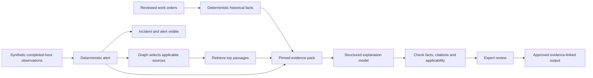

# Implement the bounded demo on top of PR #14

**Outcome:** demonstrate one synthetic pump incident from trusted work-order history and a completed-hour check to applicable retrieved context, a cited hypothesis, explicit expert review and an evidence-linked report. Keep all numeric decisions deterministic.

This is proposed implementation work, not code delivered by this pack. The user's latest direction explicitly retains bounded RAG and graph support. The broader [confirmed workflow](../PROPOSED_SYSTEM_WORKFLOW.md) remains authoritative. PR #14's historical-work-order scope is a base module; it does not replace the monitoring/response direction.

## Demo boundaries

- One authored synthetic pump model (`DEMO-P100`), one main asset, one decoy model and one operating regime.
- Three labelled channels: bearing temperature, vibration RMS and motor current. One-hour windows use event time and explicit Bangkok/UTC conversion; an accelerated playback clock changes speed, not the window definition.
- At most 30 authored/approved document chunks, a small versioned applicability graph and reviewed work-order records.
- One application with logical modules. Start with a JSON adjacency graph and deterministic lexical top-three retrieval. Embeddings, graph databases and agent orchestration are later options if measurements justify them.
- Display the alert before asking the model for an explanation. Model/retrieval failure must not remove the numeric alert or block expert investigation.
- Show supported explanation, absent evidence, wrong-model evidence and model-unavailable branches.
- A guided expert review supports accept/correct/reject/inconclusive; maintenance approval is a separate explicit action. No equipment-control integration.

### Stretch after the core path passes

Add the existing two-job, qualification-filtered dispatch fixture and human-approved recovery/case publication. These are a second demo slice, not prerequisites for the first context-aware incident. Real telemetry, learned forecasting/RUL, a generic graph reasoning engine, automatic repairs and autonomous dispatch remain outside this slice.

## Responsibility and data flow



The graph establishes recorded applicability, not causation. Retrieval finds context, not a decision. The model proposes an explanation and uncertainty; checks can reject invalid claims but cannot prove a causal hypothesis. A person confirms findings and authorises an inspection/repair scope.

Keep historical triage priority separate from current-hour condition status. A component mention count is not an hourly failure probability. Do not sum or multiply these two scores into a new number without a defined model and approval.

## Extend the real PR contracts

PR baseline: `00ad51d14f8be5cd754e524343f4280cb8cc7fba`. The source checkout for this guide is a separate documentation branch. Do not overwrite it, merge branches or assume `ignis_wo` exists there.

| Proposed path in the implementation checkout | Responsibility | Integration contract |
|---|---|---|
| `ignis_wo/review.py`, `pipeline.py`, `artifacts.py` | Correct review and failure prerequisites | Explicit decisions; per-run outputs; terminal stage status |
| `ignis_demo/contracts.py` | Evidence, graph, hourly assessment and explanation models | Do not overload existing span extraction or component triage contracts |
| `ignis_demo/condition.py` | Synthetic window features and numeric alert | `FactRow`-compatible metric/entity/unit/interval bindings, independent of model |
| `ignis_demo/context/graph.py` | Filter applicable models/components/document revisions | Return eligible chunk IDs plus versioned path IDs; no inferred causation |
| `ignis_demo/context/retrieve.py` | Rank only eligible passages | Stable tie-breaking, top-three limit, scores and empty-result state |
| `ignis_demo/context/pack.py` | Freeze facts, paths and passages | Content hash + source references + snapshot/version IDs |
| `ignis_demo/reasoning/adapter.py` | Prompt/structured output; fixture/replay/live modes | Separate task/model identity from `ExtractionOutput` |
| `ignis_demo/reasoning/validate.py` | Reject wrong bindings and missing references | Typed facts checked in code; contextual support reviewed by expert |
| `ignis_demo/incidents.py` | Explicit review state transitions | Attributed review revision and time; no model-written approval |
| `ignis_demo/render.py` | Incident detail and approved report annex | Show alert, evidence, hypothesis, uncertainty, review state and mode |
| `tests/test_demo_context.py`, `tests/test_demo_failures.py` | Meaningful contracts and failure cases | Cases from the evaluation plan; no tests of implementation trivia |

Keep `ignis_wo.analytics.explain` for its current deterministic component summary. Add a separate `ContextualExplanation` for evidence-based hypotheses. Existing `render/claims.py` checks fact/template bindings; do not claim it validates the truth of new free-form explanations.

Extend the PDF with a clearly marked expert-reviewed context annex rather than replacing deterministic report sentences. An unapproved explanation appears only as a draft. Failure to render the annex leaves an error/draft state and preserves the alert.

## Execution sequence and acceptance gates

### Phase 0 — make the foundation trustworthy

Implementation responsibility: pipeline/review owner, assigned by the team.

1. Remove implicit confirmation/acceptance for source data; require reviewed mapping and per-record decisions. If retained for fixtures, a demo-only switch must visibly identify automatic approval.
2. Use a unique run directory, record failed stages for parser/network/review/render exceptions, and publish report outputs atomically on success.
3. Show missing-attribution warnings and qualify zero severity as no attributed fault.
4. Preserve approval attribution, revision time/history and report sign-off; content reproducibility is not a reason to erase audit times. Re-rendering the same pinned run may be deterministic while a new approval creates a new revision.
5. Reject nonfinite/negative downtime and validate source units/dates before using them in computed facts.

Acceptance: PR tests pass; no real-data run silently approves records; failed reruns cannot advertise an old report as new; model outage records a failed/degraded explanation state. The baseline tests are necessary but do not cover all these new behaviors.

### Phase 1 — prepare scoped evidence on CPU

Implementation responsibility: context/data owner, assigned by the team. Depends on Phase 0 review contract.

1. Build the original synthetic pump fixture from [demo-context.json](fixtures/demo-context.json). These engineering assertions are demo inventions, not manufacturer guidance.
2. Version graph nodes/edges with origin, applicable model/component, source ID and reviewer state. Only approved relations enter retrieval scope.
3. Curate 10-30 short document chunks and 3-5 separately reviewed synthetic case examples. Retain raw documents, chunk offsets and revisions.
4. Search eligible chunks with lexical matching; save the query, eligible IDs, ranks, scores and graph path. Top three is a limit, not a requirement to return irrelevant material.
5. Freeze the evidence pack. For missing identity/version metadata, return insufficient applicability rather than broadening retrieval.

Acceptance: the decoy manual can never reach the reasoning input; applicable evidence has traceable paths; empty evidence has a visible state; same inputs produce the same pack hash.

### Phase 2 — demonstrate a numeric alert and cited explanation

Implementation responsibility: application/model owner, assigned by the team. Depends on Phase 1.

1. Read synthetic observations, seal a completed hour and calculate features in code. The fixture uses a separate approved healthy baseline and operating regime.
2. Persist/display the alert first. Retrieve its context and assemble only applicable typed evidence.
3. Use the separate structured explanation prompt from [reasoning-example.json](fixtures/reasoning-example.json). Never add RAG text to the raw input whose extraction offsets must match.
4. Validate schema, evidence IDs, metric value/unit/entity/interval and graph/document versions. Unknown references, wrong numbers and out-of-scope sources invalidate the draft.
5. Present cited hypotheses and alternatives to an expert. Repair scope requires explicit approval after explanation review; inconclusive review leaves diagnosis unresolved.

Acceptance: numeric alerts/triage do not change between model outputs; an unsupported failure time or cause is rejected or labelled unconfirmed; outage leaves alert and evidence accessible.

### Phase 3 — integrate the review screen and report

Implementation responsibility: application/report owner. Depends on Phase 2.

Use the PR's board as a starting point; a thin local Python application can serve the incident detail and review actions, avoiding a new frontend stack for the first slice. A static HTML page alone cannot persist real review actions. Maintain one logical store (for example SQLite) plus content-addressed evidence files.

Display five connected views: input/mapping review, work-order annotation review, current numeric alert, retrieved evidence plus hypothesis review, and approved report. They can be tabs/panels in one page. Show source/fixture/replay/live status throughout. Scope this to one named local demo operator; it is not production multi-user authorization.

Acceptance: decisions persist through reload; review revisions preserve the evidence version; report claims resolve to pinned facts; draft or rejected diagnoses are never shown as confirmed findings.

### Phase 4 — qualify adaptation and rehearse

Model owner works after CPU fixtures and the untuned baseline are recorded. GPU access and exact AMD-compatible training/serving runtime remain unverified; choose them through a real smoke test rather than prescribing untested installs.

- Extraction LoRA: MaintIE train only -> dev comparison -> accepted candidate -> single final test. Publish model/data/prompt/runtime identities with results.
- Evidence-use pilot: screen Industrial-Instruction and establish permissible intended use; pin one config and train a separate adapter. Score its original task plus the frozen IGNIS cases. Do not claim multiple-choice gains prove diagnosis quality.
- First-demo explanation: explicitly select the prompted base model or a qualified explanation adapter. Record that selection; never silently fall back between them. An extraction adapter is not automatically an explanation adapter.
- Capture real model responses for replay only after qualification. Gold fixtures prove plumbing; authored fixtures prove scenario handling; replay proves repeatability of captured responses. Only actual held-out live inference measures model performance.
- Run the [ablation and failure checks](EVALUATION_PLAN.md). Rehearse an ordinary case, a wrong-model source, absent evidence and model outage.

## Real commands and planned work

On a Windows implementation checkout containing PR #14, these existing commands are valid:

```powershell
uv run --no-project --with-requirements requirements-dev.txt python -m unittest discover -s tests -v
uv run --no-project --with-requirements requirements-dev.txt python scripts/check_repository.py
uv run --no-project --with-requirements requirements-dev.txt python scripts/fetch_maintie.py
uv run --no-project --with-requirements requirements-dev.txt python scripts/make_demo_export.py --seed 7
uv run --no-project --with-requirements requirements-dev.txt python -m ignis_wo run --input data/demo/export.xlsx --out outputs/demo-run-001 --synthetic
```

The final command currently exercises PR #14's fixture path, including its automatic-review limitation. It does not exercise the proposed RAG/graph extension. After Phase 0, supply the explicit mapping/review decisions using the implemented review workflow. Use a new output directory per run.

No `ignis_demo` command or endpoint exists yet. Design its interface during implementation and document actual runnable commands after verification. Do not present planned flags as installed functionality.

## Suggested allocation and cut order

Allocate three responsibilities, not eleven services: pipeline/review, context/data, application/model/report. Names and ownership remain a team decision. Estimated effort is four focused build sessions plus a rehearsal, assuming the PR baseline is ready and one model endpoint is available; this is a planning assumption, not a promised deadline.

If time runs short, cut embeddings, explanation fine-tuning, new public telemetry data, dispatch and automated knowledge publication first. Retain explicit review, alert independence, applicable evidence, cited output, visible uncertainty and an honest mode label. If no model is available, show the authored fixture/replay path explicitly and do not claim trained inference.
